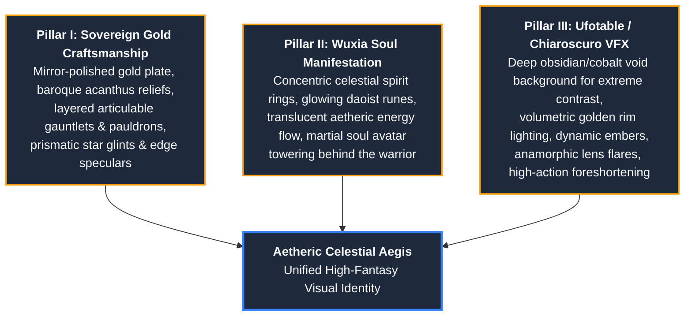

# Art Concept & Visual Identity Engine: Aetheric Celestial Aegis

## Mission

Govern visual direction, character sheet designs, power manifestation illustrations, and scene concepts across the narrative framework. Standardizes prompts and artistic specifications into the **Aetheric Celestial Aegis** visual style—a signature aesthetic synthesizing classical high-tier gold armor craftsmanship, wuxia spirit manifestations, and cinematic anime studio lighting.

---

## 1. Aesthetic DNA: The Tri-Pillar Synthesis



---

## 2. Key Visual Style Guidelines

### A. Armor & Costume Design
- **Materials:** Multi-layered, mirror-finished imperial gold plate armor with intricate raised baroque filigree, lion or dragon crests, and layered greaves and pauldrons.
- **Under-layer:** Deep royal navy, midnight black, or crimson silk weave beneath articulated golden plates.
- **Anatomy & Proportions:** Heroic shonen / seinen proportions, sharp jawline, intense focused gaze, dynamic martial arts stance with dramatic foreshortening.

### B. Energy & Power Effects
- **Spirit Rings / Astral Halos:** Concentric luminous rings hovering behind the back or encircling the body, adorned with ancient calligraphic runes. Each ring emits distinct luminosity corresponding to its energy rank (e.g., golden-white, deep obsidian black, crimson soul-radiance).
- **Aura & Inherent Pressure:** Ribbons of translucent prismatic light refracting around the armor edges; heavy spiritual pressure rippling the surrounding atmosphere.
- **Particles:** Micro-embers of incandescent gold, floating stardust filaments, and sharp lens glints.

### C. Lighting & Color Palette
- **Palette Hierarchy:**
  - *Dominant (60%):* Deep space obsidian, midnight navy, charcoal shadow void.
  - *Secondary (30%):* Polished imperial gold, radiant sunlight yellow, warm amber edge-lighting.
  - *Accent (10%):* Crystalline soul cyan, crimson divine flame, or ethereal violet highlights.
- **Lighting Technique:** Extreme chiaroscuro with strong key lighting from power manifestations and intense volumetric rim lighting separating the silhouette from the backdrop.

---

## 3. Master Prompt Generation Template (FLUX / Midjourney)

When generating concept art prompts for characters, weapons, or battles, use this standardized structure:

```text
[Subject & Action]: Dynamic heroic full-body portrait of a regal young warrior in a powerful martial arts stance, dynamic foreshortening, intense determined gaze.
[Costume & Armor]: Clad in magnificent baroque-styled mirror-polished gold plate armor, lion head filigree relief on massive layered pauldrons, articulated gauntlets, royal midnight blue silk undertunic.
[Aura & Manifestation]: Concentric luminous celestial spirit rings hover serenely behind his back, etched with radiant ancient runes, translucent golden energy ribbons flowing and distorting the space around him.
[Environment & Lighting]: Standing amid an abstract cosmic void with floating crystalline fragments, dramatic chiaroscuro lighting, strong golden volumetric rim light, glowing particle sparks and star glints.
[Style & Technical]: Elite digital anime concept illustration, Ufotable and Fate/Grand Order style, dramatic cinematic composition, 8k resolution, immaculate line art, intricate filigree details, sharp focus, raytraced reflections --ar 16:9 --style raw
```

### Standard Negative Prompts:
```text
blurry, low quality, flat lighting, plastic texture, desaturated, muddy colors, deformed hands, missing fingers, extra limbs, cartoonish, 3d render distortion, watermark, text, signature
```

---

## 4. Integration with Vault Artifacts

- **Character Design Sheets:** When authoring `02_Story_Bible/Characters/` pages or `Meta/Templates/Design_Sheet.md`, attach visual prompts and color palettes derived from this skill.
- **Cover & Chapter Artwork:** Maintain uniform visual coherence across all story volume illustrations by referencing the three pillars.
