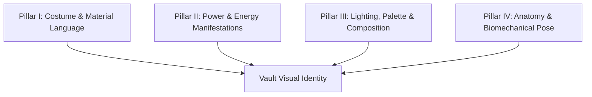
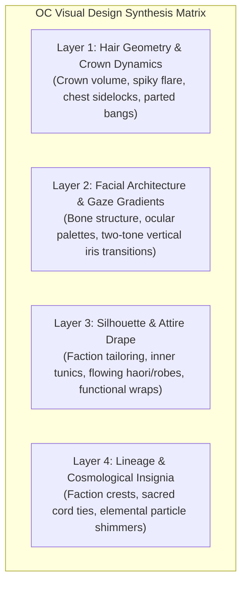

# Art Concept & Universal Visual Identity Engine

## Mission

Govern visual direction, character appearance sheets, power manifestation illustrations, and scene concepts across any fictional universe, cosmology, or original setting in the vault.

The visual identity is **the curator's**: it is anchored in the vault's design sheets, character dossiers, and scene blueprints, never hardcoded into this skill.

This engine produces **genuinely universal image prompts** by dynamically interpreting the active project context—utilizing authentic canonical terminology rather than generic deconstructions—and guarantees **EXACTLY ONE UNIVERSAL MASTER PROMPT** and **EXACTLY ONE DEDICATED NEGATIVE PROMPT** per invocation.

---

## 1. Context-Driven Universalization (No Franchise Deconstruction)

Universalization applies to the skill's **underlying methodology, adaptability, and prompt architecture**, NOT to making generated artwork generic.

### 1.1 Strict Prohibition: Never Deconstruct Fictional Universes
Commercial image generators and safety scanners do NOT require stripping away a story's identity. 
- **DO NOT** replace canonical character names, locations, organizations, abilities, or items with generic descriptions (e.g., do not replace *"<Character Name>"* with *"a young girl from an ancient noble eastern lineage"*).
- **DO NOT** replace in-universe terminology with vague fantasy or sci-fi substitutes.
- **DO NOT** avoid direct names or lore merely because they belong to an existing intellectual property.
- **USE ACTUAL CANONICAL NAMES AND TERMINOLOGY** appropriate to the requested universe.

### 1.2 Dynamic Contextual Interpretation
Derive all visual, lore, and aesthetic parameters directly from the invocation context:

- **Dragon Ball:** Use canonical character names, martial arts schools (`Turtle School Gi`, `Crane School`), transformations (`Super Saiyan`), energy manifestations (`Ki aura`, `energy spheres`), capsules, and iconic planetary landscapes.
- **Original & Other Cosmologies:** Apply the same contextual fidelity using the project's specific source material, worldbuilding rules, factions, and aesthetics.

---

## 2. Vault Visual Identity Framework (Recovered Core Principles)

Every visual asset in the vault must adhere to a coherent design philosophy established in the vault's character profiles and design sheets (`99_System/Templates/TPL_Bible_Cast_Profile.md`):



### 2.1 The Four Visual Pillars:
1. **Costume & Material Language:** Layered textiles, cultural weaves, armor plates, faction crests, belts, sashes, and functional footwear appropriate to the setting.
2. **Power & Energy Manifestations:** Distinct visual behaviors for supernatural energies (shape, color, luminosity, particle density, and atmospheric heat/pressure) tied to tier and rank.
3. **Lighting, Palette & Composition (The 60-30-10 Rule):**
   - **60% Dominant:** Primary background/costume tone establishing atmosphere.
   - **30% Secondary:** Contrasting structural elements (haori, armor plates, garments).
   - **10% Accent:** High-luminosity highlights (energy aura, crest embroidery, eye color).
   - *Atmospheric Lighting:* Volumetric golden-hour rim lighting, cinematic mist, or directional sunlight.
4. **Anatomy & Biomechanical Pose:** Expressive gesture, genre-appropriate proportions, and realistic weight distribution.

### 2.2 Original Character (OC) Visual Design Synthesis Matrix

When defining or prompting Original Characters (OCs) or alternate-universe composite figures (such as the protagonist), avoid generic or disconnected anime descriptions. Instead, articulate a cohesive visual design synthesis anchored in distinct source archetypes across four architectural layers:



1. **Hair Geometry & Crown Dynamics:**
   - Define exact volumetric flow, crown silhouette (e.g., voluminous flared crown radiating outward like wings/flames as in *Hades True Body*), forehead bangs (e.g., center-parted curtain bangs), and frontal draping (e.g., two dense symmetrical chest sidelocks echoing *Indra Ōtsutsuki* or *Miyamoto Musashi*).
2. **Facial Architecture & Gaze Gradients:**
   - Articulate bone structure (e.g., sharp aristocratic jawline, serene bishōnen demeanor).
   - When eyes reflect dual lineages, define an organic vertical color gradient (e.g., deep *crimson-red* at the upper iris smoothly dissolving into rich *royal violet* at the lower edge) rather than flat or mismatched heterochromia.
3. **Silhouette & Attire Drape (Faction & Wanderer Tailoring):**
   - Synthesize cultural garments into a unified, functional silhouette (e.g., fitted inner tunic + hakama trousers + flowing open-front haori + dual-layer sash and shoulder cord ties).
   - Ensure the silhouette balances martial readiness with effortless casual elegance (contrapposto weight settling).
4. **Lineage & Cosmological Insignia:**
   - Anchor the character within vault cosmology through subtle, refined visual markers: minimal faction crest embroidery, sacred cord accents (*tasuki*), and ambient energy shimmers (e.g., crystalline air shimmers, morning mist, floating water droplets).

---

## 3. Pre-Generation Deep Search: Pose & Anatomy Reference Engine

**MANDATORY STEP:** Before drafting the image generation prompt, execute a visual reference analysis to ensure natural biomechanics and eliminate stiff, artificial poses:

### 3.1 Search Query Strategy
Query targeted reference terms based on subject demographic, archetype, and scene context:
- **Female Subjects:** `anime female poses drawing reference [archetype] [action]`  
  *(e.g., `anime female poses drawing reference balanced sword stance`, `anime female poses drawing reference defiant hands on hips spirited standing`)*
- **Male Subjects:** `anime male poses drawing reference [archetype] [action]`  
  *(e.g., `anime male poses drawing reference swordsman serene standing relaxed`, `anime male poses drawing reference tactical crouch ready stance analytical`)*

### 3.2 Biomechanical Extraction Checklist
From drawing references, extract and apply six physical mechanics:
1. **Center of Gravity & Grounding:** Measure weight settling (e.g., 60% on forward flat foot, 40% on rear ball of foot; or centered low between feet).
2. **Contrapposto & Weight Distribution:** Asymmetrical pelvic tilt counterbalanced by opposing shoulder girdle angle.
3. **Spine Line-of-Action:** Define kinetic intent via a gentle organic 'S-curve' (composure/grace) or dynamic diagonal 'C-curve' (readiness/lunge).
4. **Torso & Pelvis Torquing:** Differential rotation between chest and hips establishing three-dimensional depth.
5. **Limb Angles & Foreshortening:** Position of leading vs. trailing limbs to reinforce perspective.
6. **Hand Tension & Finger Articulation:** Dextrous grip, relaxed curled fingers, or poised mudra reflecting psychological state.

Inject these mechanics into the Visual Pillars under `*Pose & Anatomical Mechanics:*` and weave them naturally into the prompt prose.

---

## 4. Safety Precision: Preventing False Positives Without Subject Alteration

Commercial safety filters (OpenAI, Gemini) frequently trigger false positives when young or teenage characters are depicted with martial-arts poses or weapons. 

**The solution is NEVER to age up characters arbitrarily, strip away their identities, or turn martial arts into passive scenes.** Instead, establish the **legitimate, disciplined, benign training context** explicitly.

### 4.1 Positive Context Framing for Minors & Martial Arts
When depicting teenagers or young apprentices in martial arts training:
- **State Canonical Identity & Age:** Clearly identify the character (e.g., `Teenage swordswoman <Character Name>`, `Young apprentice <Character Name> around 10 years old`).
- **Explicit Training Framing:** State unequivocally that the scene is a *disciplined martial arts training session*, *supervised practice*, or *traditional form demonstration*.
- **Modest, Complete, Functional Attire:** Explicitly describe full, modest, age-appropriate training garments (e.g., *high-collar tunic, modest compression shorts, protective forearm cloth wraps, regulation training sandals*).
- **Blunt Practice Equipment:** Explicitly designate weapons as practice gear (e.g., *blunt wooden practice training sword / bokken*, *ornamental blunt training prop blade*).
- **Controlled, Poised Posture:** Describe the stance as *balanced, controlled, poised, and intended for formal sword practice*.
- **Wholesome Atmosphere:** Establish a peaceful, disciplined atmosphere (e.g., *scenic traditional wooden academy training grounds at sunset, autumn leaves, round wooden practice targets*).

### 4.2 Negative Prompt Safeguards
In the dedicated negative prompt, incorporate precise exclusions:
- **Prevent Sexualization:** `revealing clothes, inappropriate attire, exposed skin, bare shoulders, low cut, cleavage, suggestive presentation`.
- **Prevent Graphic Violence:** `blood, gore, open wounds, injuries, combat damage, graphic brutality, lethal violence, aggressive confrontation`.
- **Preserve Legitimate Gear:** Do NOT indiscriminately exclude all weapons (e.g., do not write `no weapons`), as that would ban the blunt wooden practice sword or training tools required by the prompt.

---

## 5. Universal Engine Compatibility & Technical Parameters

### 5.1 Multi-Engine Execution Strategy
A single well-crafted master prompt satisfies all major engines simultaneously:
- **ChatGPT / DALL-E 3:** Interprets fluent, rich narrative prose; avoids filter triggers through explicit benign training framing; absorbs positive quality constraints cleanly.
- **PixAI.art:** Responds to Danbooru CLIP tokens naturally embedded in prose (`solo`, `jet-black hair`, `pleated skirt`, `sunset`, `cinematic lighting`).
- **Midjourney v6 / Niji 6:** Thrives on textural descriptors, volumetric lighting, and painterly atmosphere.
- **Stable Diffusion / Flux:** Follows structured composition flow: Camera framing ➔ Subject & Age ➔ Facial details ➔ Complete attire ➔ Pose mechanics ➔ Practice gear ➔ Environment ➔ Lighting ➔ Quality constraints.
- **Google Gemini / Nano Banana:** Adheres to spatial aspect ratios (16:9 widescreen or 9:16 vertical) and scene compositions.

### 5.2 PixAI.art Technical Parameters
- **Base Models:** *Tsubaki.3* (high aesthetic anime fidelity) or *Haruka* (delicate facial shading).
- **LoRA Weights:** Single LoRA: **0.75 – 0.85**; Stacked LoRAs: **0.50 – 0.65** each.
- **ControlNet:** *OpenPose* (locks biomechanical posture) or *Lineart/Canny* (from design sketches).
- **Parameters:** Sampler `DPM++ 2M Karras` or `Euler a`, Steps `26 – 30`, CFG Scale `7.0 – 8.0`.

### 5.3 Positive Constraint Engineering (Prose Safety)
Commercial engines like ChatGPT / DALL-E 3 do not feature a negative prompt box. Banned words inside prose abort the generation.
- **Rule:** Never put negative lists inside the master prompt prose.
- **Rule:** Always conclude prose prompts with positive quality assertions:
  ```text
  Masterpiece, crisp clean lineart, dynamic cinematic lighting, rich digital painting, flawless anatomy with five clearly articulated fingers per hand, modest traditional anime attire, pristine details, no text, no watermarks, no artist signatures.
  ```

---

## 6. Critical Output Requirement: Exactly ONE Version of Each Prompt

**NON-NEGOTIABLE CONTRACT:** Every normal image-generation invocation must produce **EXACTLY:**
1. **ONE Universal Master Image Generation Prompt**
2. **ONE Dedicated Negative Prompt**

### Strict Prohibitions:
- **NO** Version 1 / Version 2 variations.
- **NO** multiple alternative prompt blocks.
- **NO** separate platform-specific prompts (e.g., one for Midjourney and another for PixAI).
- **NO** duplicate prompt pairs under different headings.
- **NO** rewritten secondary versions later in the response.

### Standard Output Template:

````markdown
### 2.x Visual Identity & Master Image Generation Prompt (`art-concept` Universal)

- **Visual Pillars:**
  - *Hair & Complexion:* <Color, hairstyle, bangs, length, texture, skin tone>
  - *Facial Architecture & Eyes:* <Face shape, emotional expression, eye shape, iris color and gradient>
  - *Attire & Silhouettes:* <Inner layers, tunic/robes, waist sashes, wraps, crest geometry, footwear>
  - *Pose & Anatomical Mechanics:* <Center of gravity, weight distribution / contrapposto, spine line-of-action, torso twist, limb angles, hand tension>
  - *Gear & Accessories:* <Practice weapons, holsters, hair clips, pouches, belts>
  - *Elemental Aura:* <Subtle energy shimmer, embers, mist, or floating particles>
  - *Setting & Lighting:* <Environment, camera framing, time of day, atmospheric lighting, volumetric depth>

#### Universal Master Image Generation Prompt
*(Copy-paste directly into ChatGPT / DALL-E 3, PixAI.art, Midjourney, Stable Diffusion, or Gemini)*:

```text
<Fluent, anti-moderation safe English prose combining camera framing, canonical character name and appropriate age, disciplined training/practice context, facial expression and hair/eye details, complete layered modest attire with canonical insignia, explicit anatomical pose mechanics with weight distribution and hand tension, practice equipment, subtle energy effects, scenic background environment, and concluding positive quality constraints (flawless anatomy with five clearly articulated fingers per hand, clean lineart, masterpiece, no watermarks).>
```

#### Dedicated Negative Prompt
*(For platforms with a separate Negative Prompt box like PixAI, Stable Diffusion WebUI, or NovelAI ONLY. Do NOT paste into ChatGPT)*:

```text
worst quality, low quality, normal quality, blurry, mutated hands, extra fingers, missing fingers, deformed fingers, malformed limbs, poorly drawn face, disfigured, revealing clothes, inappropriate attire, bare shoulders, exposed skin, combat damage, blood, injuries, gore, weapons drawn aggressively, text, logo, watermark, signature
```
````
