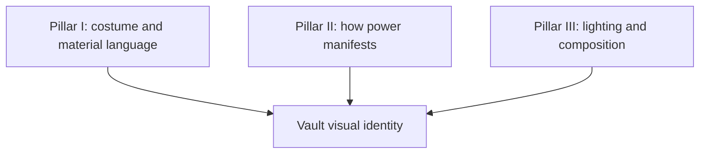

# Art Concept & Visual Identity Engine

## Mission

Govern visual direction, character sheet designs, power manifestation illustrations and scene concepts across the vault. The visual identity is **the curator's**: it lives in the vault's design sheets (`Meta/Templates/TMP-Design_Sheet.md` is the blueprint), never in this skill. Without a defined identity, ask the curator for it before generating prompts.

---

## 1. Define the Visual Identity Once

Record, in one design sheet, the pillars of the look (for example materials and costume language, how power is shown, lighting and colour) so every later prompt reuses them.



---

## 2. Style Guidelines to Fill In

- **Costume & Materials:** the recurring materials, silhouettes, crests and under-layers of the setting.
- **Energy & Power Effects:** shape, colour and intensity of each power's visible effect, tied to its rank.
- **Lighting & Palette:** a dominant (about 60 %), secondary (about 30 %) and accent (about 10 %) colour, and the lighting technique.
- **Anatomy & Proportions:** the proportion style and pose language that suit the genre.

---

## 3. Master Prompt Template

When generating concept art for characters, weapons or battles, use this structure and fill each line from the design sheet:

```text
[Subject & Action]: <who, doing what, camera angle>
[Costume & Armor]: <materials, crests, layers from the design sheet>
[Aura & Manifestation]: <how this character's power looks>
[Environment & Lighting]: <setting, light direction, atmosphere>
[Style & Technical]: <medium, reference style, resolution, aspect ratio>
```

### Standard Negative Prompts:
```text
blurry, low quality, flat lighting, plastic texture, desaturated, muddy colors, deformed hands, missing fingers, extra limbs, watermark, text, signature
```

---

## 4. Integration with Vault Artifacts

- **Character Design Sheets:** When authoring `02_Story_Bible/Characters/` pages or design sheets, attach the visual prompts and colour palettes derived from this skill.
- **Cover & Chapter Artwork:** Keep illustrations coherent by referencing the same pillars.
