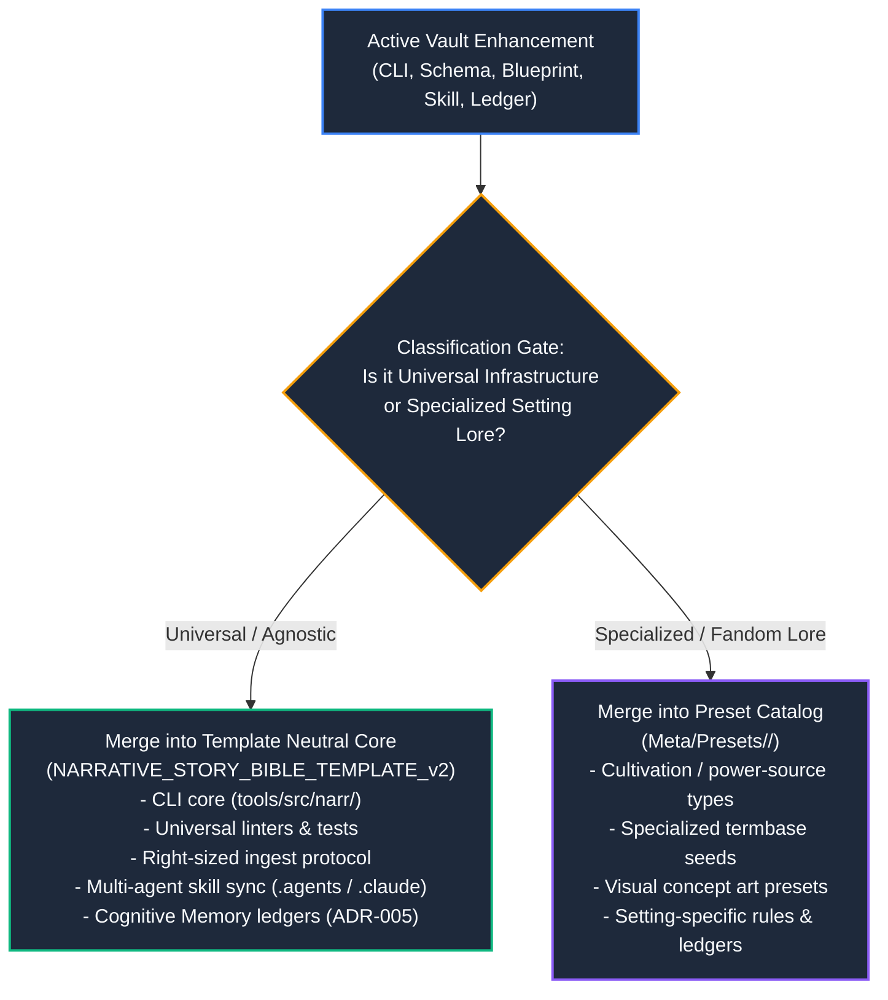

# Framework Synchronization & Preset Governance

## Mission

Govern the bidirectional flow of infrastructure, schemas, rules, skills, and specialized lore between the central framework (`NARRATIVE_STORY_BIBLE_TEMPLATE_v2`) and individual story vaults (e.g. `My_Fandom-`). Ensure that the upstream framework base remains **100% neutral and IP-agnostic**, while all fandom-specific innovations are cleanly routed into the **Modular Presets Catalog** (`Meta/Presets/`) without configuration drift or structural contamination.

---

## 1. The Bifurcated Promotion Architecture (Rule 60)

---

## 2. Change Classification Protocol

Every proposed enhancement must be classified under one of two mutually exclusive tracks:

### Track A: Universal Infrastructure (Promote to Template Core)
- **Criteria:** Enhancements that benefit *any* narrative genre, worldbuilding project, or fanfiction vault.
- **Examples:**
  - Improvements to `narr` CLI (`blueprint.py`, `ingest.py`, `checks.py`, `doctor.py`).
  - Unit test expansions under `tools/tests/unit/`.
  - Right-sized baseline consolidation algorithms (3 KB - 15 KB bounds).
  - General reasoning, translation, and chapter generation prompts in `prompt.py`.
  - Multi-agent parity and synchronization mechanisms.
- **Sanitization Invariant:** Must be stripped of all IP-specific names, terms, or entity identifiers. Use generic placeholders (`[[CHR-Pending]]`, `[[LOC-Pending]]`, `[[PWR-Pending]]`).

### Track B: Specialized Setting Lore (Harvest into Presets Catalog)
- **Criteria:** Innovations tied directly to a specific intellectual property, magic system, cultivation hierarchy, or fandom lore.
- **Examples:**
  - Setting-specific rank tables, innate powers, relics, and godhood attributes.
  - Type definitions for superhero power classes, chakra natures, or zanpakuto states.
  - Specialized fandom dictionaries and translation glossaries.
- **Routing Invariant:** Never commit setting-specific lore directly to the neutral template root. Route exclusively to `Meta/Presets/<fandom>/manifest.json` and `Meta/Presets/<fandom>/seeds/`.

---

## 3. Upstream Promotion Workflow (Vault -> Template)

Follow this 4-step sequence when promoting features from an active story vault to the template:

1. **Extract & Abstract:**
   - Copy the modified tool, skill, or test from the vault.
   - Sanitize all fandom entities into generic placeholders.
2. **Deploy to Template:**
   - Apply edits to `NARRATIVE_STORY_BIBLE_TEMPLATE_v2`.
3. **Execute Template Quality Gates:**
   - `python -m pytest tools/tests/unit -v` (Must pass 100%).
   - `narr doctor` (Must pass 4/4 checks with Multi-Agent Parity: Synchronized).
   - `narr lint` (0 errors, 0 warnings).
   - `narr crosscheck` (0 issues).
4. **Synchronize Multi-Agent Skills:**
   - Ensure identical copies exist in `.agents/skills/` and `.claude/skills/`.

---

## 4. Downstream Inheritance Workflow (Template -> Vault)

When the template receives core architectural upgrades, propagate them back to active story vaults:

1. **Tooling & CLI Sync:**
   - Synchronize `tools/src/narr/` and `pyproject.toml`.
2. **Skill Catalog Sync:**
   - Copy updated skills to both `.agents/skills/` and `.claude/skills/` in the story vault.
3. **Preserve Vault State:**
   - Never overwrite user story files, canon baselines, or ledgers during template synchronization.
4. **Execute Vault Quality Gates:**
   - Run `narr doctor`, `pytest`, `narr lint`, and `narr crosscheck` in the active story vault to verify complete integrity.
