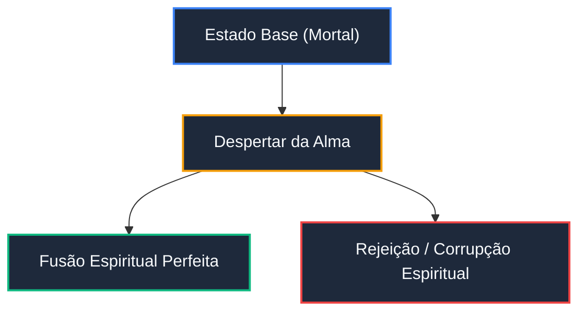

# Mermaid Diagram Engineering for Narrative Vaults

Use this skill whenever a narrative relationship, power progression, chronological timeline, or faction hierarchy benefits from visual representation.

---

## 1. Core Diagrammatic Invariants

1. **Zero ASCII Art (VAL009):**
   - NEVER generate box-and-arrow diagrams using `+--`, `|`, or text blocks.
   - Always place diagrams in a fenced code block with identifier ````mermaid`.
2. **Deterministic Label Quoting:**
   - Always enclose node labels in double quotes if they contain spaces, parentheses, brackets, colons, or punctuation:
     - Correct: `node_a["Shinigami Substituto (Ichigo)"]`
     - Incorrect: `node_a[Shinigami Substituto (Ichigo)]`
3. **Zero HTML in Labels:**
   - Do not inject `<br>`, `<b>`, or HTML formatting inside node text. Use standard multi-line strings or Markdown styling supported by the renderer.
4. **Restraint & Purpose:**
   - A diagram must convey relational structure faster than a simple markdown list or table. If a table is clearer, use a table.

---

## 2. Diagram Type Mapping for Narrative Vaults

| Narrative Need | Diagram Type | Starter Syntax | Key Practices |
|:---|:---|:---|:---|
| **Evolução de Poder & Linhagens** | `flowchart TD` / `LR` | `flowchart TD` | Use direções consistentes (Top-Down para hierarquia, Left-Right para tempo). |
| **Linha Temporal de Eras / Arcos** | `timeline` | `timeline` | Agrupe eventos por Época/Arco, evitando nós superlotados. |
| **Batalhas & Fases de Confronto** | `sequenceDiagram` | `sequenceDiagram` | Mostre turnos de combate, trocas de técnicas e quebras de ritmo. |
| **Estados Psicológicos & Formas** | `stateDiagram-v2` | `stateDiagram-v2` | Represente transições de postura, transformações e estados de frenesi. |
| **Relações de Parentesco & Facções** | `erDiagram` ou `classDiagram` | `erDiagram` | Mapeie lealdades, rivalidades e laços de sangue com cardinalidade explícita. |
| **Cosmologia & Planos Astrais** | `mindmap` | `mindmap` | Estruture dimensões, reinos espirituais e planos divinos de forma associativa. |

---

## 3. Padrão Estético de Classes Modernas

Para manter alto contraste e legibilidade tanto em temas claros quanto escuros no Obsidian e GitHub:



---

## 4. Checklist de Validação
- [ ] O bloco usa ````mermaid` e não ````text`?
- [ ] Todos os nós com caracteres especiais usam aspas duplas `["..."]`?
- [ ] O diagrama está livre de tags HTML brutas?
- [ ] O comando `narr lint` executou sem violações do código `VAL009`?
