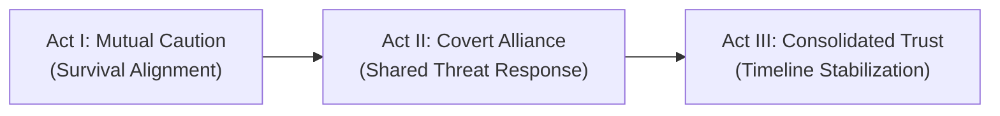

# Relationship Matrix: {{focal_character}}

> **Bible Relational Network** — Dynamic interpersonal tensions, secrecy distribution, and loyalty thresholds across narrative arcs.

---

## 1. Matrix Overview & Narrative Core

[Provide a concise 1–2 paragraph summary detailing the focal character's social position, faction dependencies, and key emotional or transactional bonds within the multiversal crossover.]

---

## 2. Primary Relationship Axes

| Entity / Character | Public / Formal Relation | Real / Operational Dynamic | Mutual Utility | Conflict Risk |
|---|---|---|---|---|
| [[{{Peer_Alpha}}]] | Fellow Squad Member | Trusted Confidant | Mutual tactical survival | Low (shared secrets) |
| [[{{Leader_Beta}}]] | Faction Commander | Wary Overseer | Institutional protection vs service | High (surveillance risk) |
| [[{{Rival_Gamma}}]] | Ideological Counterpart | Lethal Antagonist | Ideological foil & pressure | Imminent |

---

## 3. Dynamic Tension & Conflict Thresholds

- **[[{{Peer_Alpha}}]]:**
  - *Current Trust Status:* Level 4 (High operational integration, shared tactical risks).
  - *Bifurcation Point:* Would fracture if protagonist's foreign origin is revealed as hostile or deceptive.
- **[[{{Leader_Beta}}]]:**
  - *Current Trust Status:* Level 2 (Surface obedience, hidden operational divergence).
  - *Bifurcation Point:* Triggers aggressive containment if anomalous energy signatures correlate to unauthorized operations.

---

## 4. Information Asymmetry & Secret Distribution Web

| Secret / Incurred Truth | Known By | Suspected By | Strictly Concealed From |
|---|---|---|---|
| Foreign Meta-Knowledge | [[{{focal_character}}]] | None | All native entities |
| Divergence Intervention Alpha | [[{{focal_character}}]], [[{{Ally_Alpha}}]] | Local Patrol Scouts | Faction High Command |
| Secondary Energy Core | [[{{focal_character}}]] | None | Medical & Sensory Divisions |

---

## 5. Evolution Across Narrative Acts

- **Act I Dynamic:** Fragile transaction, navigating formal protocol, establishing boundaries.
- **Act II Dynamic:** Operational reliance, shared trauma, gradual revelation of selective truths.
- **Act III Dynamic:** Unconditional mutual reliance or inevitable ideological confrontation.

