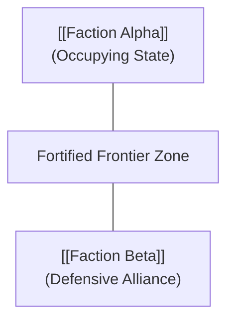

> [!WARNING] **AU OVERRIDE: SUPERCEDES CANON**
> The geopolitical borders, environmental conditions, or territorial distributions in this dossier alter official canon.

# World Delta: {{location_or_realm}}

---

## 1. World Shift Overview & Scope

| Dimension | Specification |
|---|---|
| **Affected Territory / Realm** | [[{{location_or_realm}}]] |
| **Cosmology / Domain** | {{primary_cosmology}} |
| **Triggering Divergence** | [[{{Associated_POD}}]] |
| **Delta Category** | Geopolitical Shift / Environmental Contamination / Relocated Stronghold |

[Provide a concise 1–2 paragraph description detailing how this region or world state differs from the official canonical baseline as a consequence of story events.]

---

## 2. Canonical Baseline vs. Fanfiction World State

| Dimension | Canonical Baseline | Fanfiction AU Reality |
|---|---|---|
| **Sovereignty / Ruling Power** | [[{{Canonical_Ruler}}]] | [[{{Divergent_Ruler_or_Council}}]] |
| **Military Garrison Strength** | Baseline peace/war footing | Reinforced defensive perimeter, forward wards |
| **Ambient Energy Saturation** | Homogeneous native energy | Incurred anomalies, cross-cosmology radiation |
| **Accessibility / Borders** | Open trade corridor | Fortified checkpoint, restricted travel quarantine |

---

## 3. Relocated Entities, Garrisons & Fortifications

- **Strategic Fortifications:** [New walls, barrier anchors, or fortified compounds erected in response to recent events.]
- **Relocated Artifacts & Vaults:** [Canonical relics moved from vulnerable historical sites into fortified shelters.]
- **Displaced Populations:** [Refugee concentrations, relocated clans, or established pioneer settlements.]

---

## 4. Metaphysical Environmental Anomalies

- **Localized Incursion Zones:** [Pockets where physical laws or energy circulation deviate from natural cosmology baseline.]
- **Environmental Hazards:** [Unstable energy storms, planar rifts, or hazardous mineral growths.]
- **Containment & Remediation:** [Active sealing arrays or specialized patrols maintaining quarantine perimeters.]

---

## 5. Geopolitical Alliances & Border Shift Map

- **Frontier Posture:** [Aggressive patrol sweeps, covert incursions, or tense diplomatic ceasefires.]
- **Treaty Modifications:** [Bilateral accords altered due to territory shifts.]

