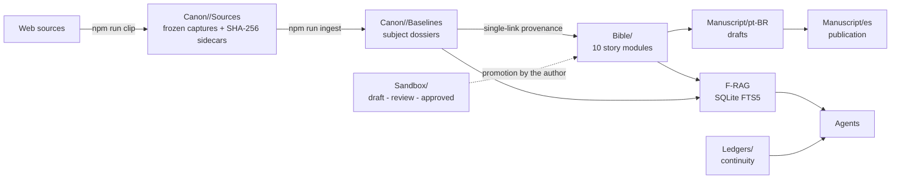
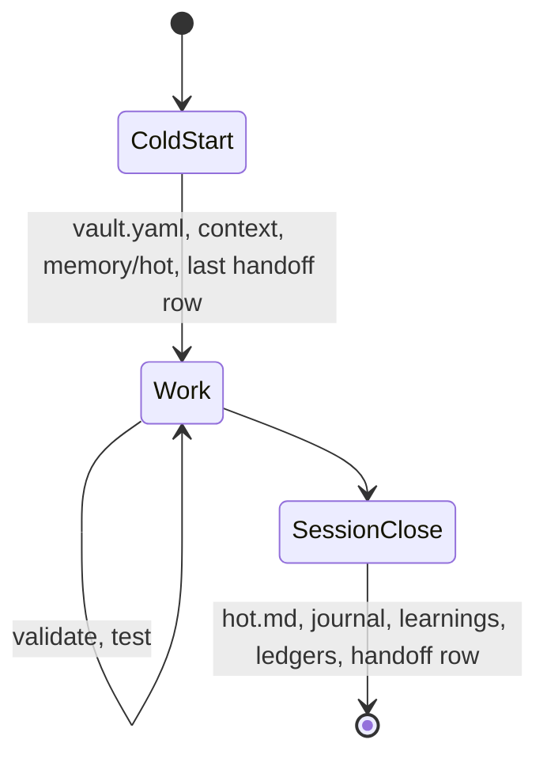

# Architecture

## Layers and data flow

## Responsibilities

| Layer | Owns | Never does |
|---|---|---|
| `Canon/` | Evidence from the adapted works | Hold story decisions |
| `Bible/` | The story's ground truth and divergences | Copy canon text (it links a single baseline) |
| `Manuscript/` | Prose | Get rewritten by agents without authorization |
| `Ledgers/` | Plants, payoffs, decisions, threads, contradictions, handoffs | Duplicate Bible content |
| `Sandbox/` | Upstream experiments | Get linked from the vault |
| `context/`, `memory/` | Voice, language rules, in-flight state | Exceed their size budgets |
| `tools/`, `tests/` | Deterministic validation and retrieval | Change without a test |

## Agent session lifecycle

## Extension points
- `vault.yaml`: story identity, tiers, thresholds, budgets.
- `99_System/franchise-rules.json`: URL-to-franchise routing and default canon tier.
- `99_System/Templates/`: typed note templates validated by `npm run validate:templates`.
- `.agents/skills/`: add or adjust agent skills; run `npm run validate:workflow` for the construction workflow set.
- `eval/queries.yaml`: golden retrieval queries for `npm run rag:eval`.
