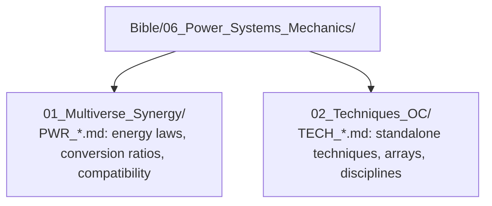

# Power Systems & Mechanics

> Operational authority for energy laws, cross-universe conversion formulas, and standalone techniques that govern the narrative.

## Module Structure

Use `TPL_Bible_Power_System` and `TPL_Bible_Technique` from `99_System/Templates/`.
