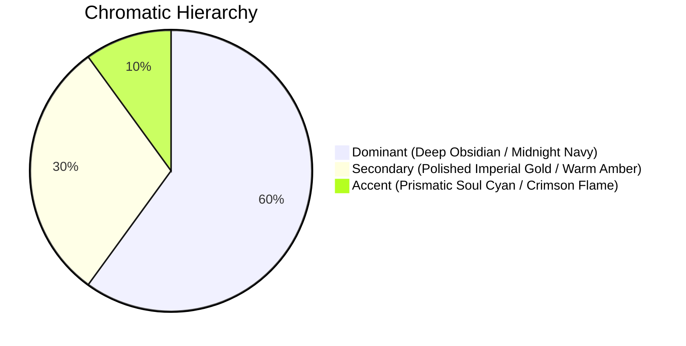

# <Character / Entity Visual Design Sheet>

> [!NOTE]
> **Executive Summary:** <2-3 sentence technical overview of the visual design sheet: character subject, aesthetic pillar synthesis, core silhouette language, and visual asset deployment across the narrative framework.>

---

## 1. Visual Identity & Silhouette Profile
<!-- 2 to 4 paragraphs establishing the physical stature, heroic silhouette, and facial aesthetics. -->

<Paragraph 1: Core silhouette and demographic proportions. Exact height in cm, anatomical build (athletic swimmer's build, broad-shouldered martial frame, agile slender runner), posture alignment, and dynamic center of gravity.>

<Paragraph 2: Facial anatomy and expressive features. Jawline structure, eye geometry (almond phoenix eyes, sharp predatory irises), eyebrow angle, hair length, texture, and natural color.>

<Paragraph 3: Demeanor and presence (*Qizhi*). The immediate visual and energetic impression conveyed when entering a scene. Does the character project unshakeable celestial tranquility, predatory vigilance, aristocratic detachment, or disciplined warmth?>

- **Height:** `<N> cm` | **Apparent Age:** `<N> years` | **Build:** `<Athletic / Heroic / Slender>`
- **Hair:** `<Color, length, styling, and motion dynamics>`
- **Eyes:** `<Iris hue, pupil geometry, luminescence under soul power activation>`

---

## 2. Chromatic Palette Hierarchy & Material Textures
*Governed by the Aetheric Celestial Aegis visual guidelines (`.agents/skills/art-concept/SKILL.md`).*



- **Dominant Base (60%):** `<Color Name> (<Hex Code>)` — Applied to undertunics, deep shadow voids, cloaks, and structural leather.
- **Secondary Armor / Metal (30%):** `<Color Name> (<Hex Code>)` — Mirror-finished gold plate, baroque acanthus reliefs, articulated gauntlets.
- **Accent Radiance (10%):** `<Color Name> (<Hex Code>)` — Concentric spirit ring halos, eye reflections, glowing runic inscriptions.
- **Haptic Material Textures:**
  - *Hard Surface:* <Mirror-polished gilded steel with engraved lion/dragon filigree.>
  - *Textile:* <Heavy midnight-blue silk brocade with silver-thread embroidery.>
  - *Leather / Utility:* <Supple black dragon-hide leather for harness and holsters.>

---

## 3. Wardrobe & Regalia Variations

### Variant A: Civilian & Academy Traveling Garb
- **Description:** <Practical, understated attire for municipal travel, market visits, and academic classes.>
- **Key Garments:** Fitted linen tunic, reinforced leather boots, unobtrusive belt concealing basic utility tools.
- **Coloration:** Muted slate, dark navy, or charcoal with discreet trim.

### Variant B: Sovereign Armature & Battlefield Regalia
- **Description:** <Full combat configuration deployed during arena duels, tournament clashes, and hunting expeditions.>
- **Key Pieces:** Sculpted baroque chestplate, articulated lion-crest pauldrons, interlocking gauntlets, and armored greaves.
- **Mobility Joints:** Flexible segmented plates ensuring unhindered acrobatic pivots and footwork execution.

### Variant C: Formal Clan / Imperial Reception Robes
- **Description:** <Ceremonial attire worn during high-stakes diplomatic banquets, sect assemblies, and imperial audiences.>
- **Key Pieces:** Flowing outer mantle, jade sash pendant, stiff high collar, and clan insignia embroidery.

---

## 4. Weapons, Soul Rings & Manifestation Phantasms
- **Primary Weapon / Tool Soul:**
  - *Total Length & Proportions:* `<Dimensions in cm>`
  - *Hilt & Crossguard Geometry:* <Ergonomic grip, counterweight pommel, engraved runes.>
  - *Blade / Shield Luster:* <Reflective sheen, luminous edge beveling, particle aura.>
- **Spirit Ring Halos (*Hunhuan*):**
  - *Configuration:* `<List of active rings by age and color (e.g., Ring 1: Yellow, Ring 2: Purple)>`
  - *Hover Alignment:* Concentric glowing halos rotating serenely behind the back, etched with ancient calligraphic runes.
  - *Particle FX:* Micro-embers of incandescent gold and floating stardust filaments refracting ambient air.

---

## 5. Master Generation Prompts (FLUX.1 / Midjourney v6)

### Positive Prompt:
```text
[Subject & Stance]: Dynamic full-body portrait of a regal young warrior, heroic shonen proportions, intense focused gaze, dynamic low-angle martial arts stance with subtle foreshortening.
[Costume & Armor]: Clad in magnificent baroque mirror-polished imperial gold plate armor with raised lion-crest filigree, articulated gauntlets, rich midnight navy silk undertunic with gold trim.
[Aura & Manifestation]: Concentric glowing spirit rings hover serenely behind his back, etched with radiant runes, ribbons of translucent golden aether refracting the air around him.
[Lighting & Atmosphere]: Dramatic chiaroscuro lighting, deep cosmic void background, intense volumetric golden rim light, glowing particle sparks and specular star glints.
[Technical Style]: High-end digital anime concept art, Ufotable studio quality, immaculate clean linework, intricate filigree detail, 8k resolution, cinematic composition --ar 16:9 --style raw
```

### Standard Negative Prompt:
```text
blurry, low quality, flat lighting, plastic armor texture, desaturated, muddy colors, deformed hands, missing fingers, extra limbs, cartoonish, 3d render distortion, watermark, signature, text
```

---

## 6. Expression & Turnaround Reference Matrix
- **Orthographic Angles:**
  - *Front View:* Full symmetrical alignment showing chestplate filigree and belt arrangement.
  - *Side Profile:* Displays pauldrons depth, spine curvature, and weapon sheath positioning.
  - *Back View:* Documents cape flow, shoulder-guard mounting, and floating spirit ring spacing.
- **Key Facial Expressions:**
  - *Demeanor 1 (Imperial Stillness):* Calm, unreadable expression; steady eyes evaluating the perimeter.
  - *Demeanor 2 (Combat Intensity):* Sharpened brow, eyes locked onto the adversary, jaw set with absolute focus.
  - *Demeanor 3 (Subtle Composure):* A faint, disciplined smile conveying complete tactical confidence.

---

## 7. Operational Lifecycle Protocols

### 7.1 Inception & Drafting Protocol (Phase 1)
1. **File Placement:** Always save under `06_Ideation_and_Unblocking/` or attach to character dossier with the exact filename `DSN-<Character_Name>.md` (zero spaces, Rule 10).
2. **Metadata Integrity:** Fill YAML frontmatter completely (`uid`, `type: concept`, `subject`, `visual_identity_pillar`, `art_status`).
3. **Prompt Formulation:** Derive FLUX/Midjourney prompt strings directly from Section 5.

### 7.2 Generation & Curatorial Review (Phase 2)
1. **Visual Parity Audit:** Ensure generated character artwork reflects established hair, eyes, and armor motifs.
2. **Ledger Attachment:** Link approved concept artwork in `02_Story_Bible/Characters/` dossiers under Visual HUD.

---

## 8. Standardized Lexicon & Taxonomy Glossary

| Term / Taxonomy | Category | Clear & Accessible Definition |
|:---|:---|:---|
| **Design Sheet (*DSN*)** | Art | An authoritative visual reference document standardizing character proportions, costumes, and color palettes. |
| **Aetheric Celestial Aegis** | Style | The unified high-fantasy visual identity synthesizing baroque gold plate, wuxia spirit halos, and chiaroscuro VFX. |
| **Chiaroscuro VFX** | Lighting | High-contrast lighting technique utilizing deep obsidian shadows and intense volumetric rim lights. |
| **Spirit Ring Halo** | Manifestation | Concentric glowing rings hovering behind a soul master representing absorbed spirit beasts and combat ranks. |
| **Orthographic Turnaround** | Production | Front, side, and back visual perspectives used to maintain model sheet consistency across illustrations. |
