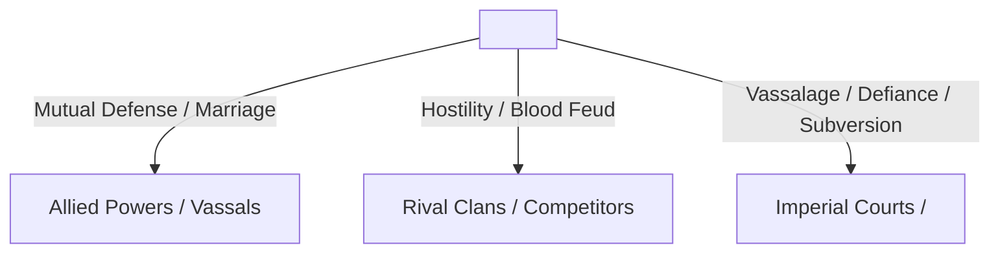

# <Faction / Organization Name>

> [!NOTE]
> **Executive Summary:** <2-3 sentence technical overview of the faction: organizational nature, political alignment, military standing, sovereign leadership, and role in continental balance of power.>

---

## 1. Ideological Creed, Core Doctrine & Public Posture
<!-- 2 to 4 paragraphs detailing public philosophy, institutional culture, and covert motives. -->

### 1.1 Public Stance & Ideology
<Paragraph 1: Public doctrine and societal mandate. What values does this organization project to the continental populace, imperial courts, and unaffiliated soul masters? (e.g., Divine salvation and awakening for commoners, aristocratic martial supremacy, pure commercial neutrality, scholarly enlightenment).>

### 1.2 Secret Agenda & True Motives
<Paragraph 2: Hidden objectives and true motives pursued by the innermost ruling circle. What grand strategy or survival mandate guides leadership? (e.g., Overthrowing secular empires to establish a theocracy, stockpiling resources for clan seclusion, avenging a generational blood debt, securing ascension to godhood).>

### 1.3 Institutional Culture & Member Ethos
<Paragraph 3: Institutional culture and member ethos. What character traits, behavioral expectations, and moral codes are instilled in disciples from induction? (e.g., Unyielding iron pride, absolute filial submission, cold mercenary pragmatism, reckless camaraderie).>

- **Institutional Motto / Clan Maxim:** `<"Official ancestral or sectarian motto">`

---

## 2. Ancestral Bloodline & Signature Heritage
- **Hereditary Martial Soul:** `<PWR-Hereditary_Martial_Soul>`
  - *Inheritance Stability:* <% Probability of pure bloodline offspring awakening this exact soul.>
  - *Clan Genetic Anomalies / Mutations:* <Known mutant variants, positive or negative.>
- **Exclusive Clan Techniques (*Zongmen Juexue*):**
  - `<TEC-Exclusive_Technique_1>`: <Functional summary and clan restrictions.>
  - `<TEC-Exclusive_Technique_2>`: <Functional summary and clan restrictions.>
- **Ancestral Heirlooms & Regalia:**
  - *Sacred Weapon / Tool:* `<ITM-Clan_Sacred_Artifact>`
  - *Inherited Spirit Bone Sets:* 

---

## 3. Hierarchical Structure & Governance Model
- **Supreme Executive:** `<CHR-Patriarch_or_Pontiff>` (Title / Rank / Absolute authority limits).
- **Council of Elders / Supreme Worshipers:**
  - *Elder Hall Composition:* `<N> Grand Elders (Title Douluo level) and <N> Standard Elders (Spirit Douluo level).`
  - *Decision Protocol:* <Autocratic decree vs. two-thirds elder council majority required for war declaration.>
- **Functional Administrative Divisions:**
  - *Combat & War Hall:* <Responsible for field deployments, hunting expeditions, and frontier defense.>
  - *Discipline & Enforcement Hall:* <Internal security, tracking renegades, enforcing secret oaths.>
  - *Logistics, Treasury & Alchemy:* <Managing clan commerce, forging workshops, medicinal herb stockpiles.>
  - *External Affairs & Intelligence:* <Diplomatic envoys, spy networks embedded in imperial capitals and arenas.>
- **Disciple Stratification:**
  - *Direct Line (*Zhixi*):* <Direct blood descendants of the founding patriarch; receive priority cultivation pills and spirit bones.>
  - *Branch Line (*Pangzhi*):* <Collateral relatives; serve as secondary officers, stewards, and regional outpost guards.>
  - *External Disciples (*Waimen*):* <Talented recruits from commoner or vassal backgrounds; bound by strict loyalty oaths.>

---

## 4. Military Prowess, Strategic Assets & Economy

### 4.1 Standing Armed Forces & Cultivation Census
| Combat Rank Tier | Title / Classification | Approximate Census | Primary Deployment Role |
|:---|:---|:---:|:---|
| **Ranks 91–99** | Title Douluo / Peak Elders | `<N> Combatants` | Strategic deterrent, apex battlefield intervention |
| **Ranks 81–90** | Spirit Douluo / Senior Officers | `<N> Combatants` | Legion commanders, high-tier hunting leads |
| **Ranks 71–80** | Soul Saint / Mid-level Elders | `<N> Combatants` | Elite tactical strike units, branch leaders |
| **Ranks 41–70** | Soul Ancestor to Soul Emperor | `<N> Combatants` | Core vanguard, specialized squad captains |
| **Ranks 11–40** | Spirit Master to Soul Elder | `<N> Combatants` | Rank-and-file disciples, perimeter security |

### 4.2 Economic Foundations & Asset Control
- **Primary Revenue Streams:** <Control of spirit metal mines, imperial subsidies, commercial taxation, auction house shares.>
- **Territorial Holdings:**
  - *Sect Bastion:* `<LOC-Headquarters_Bastion>` (Defensive formations, hidden emergency escape tunnels).
  - *Regional Outposts:* <List of key secondary strongholds, branch academies, or trade offices.>

---

## 5. Diplomatic Alignment & Relational Matrix

- **Staunch Allies & Vassals:** `<FAC-Allied_Sect_1>`, `<FAC-Vassal_Clan_2>` (Nature of treaty, joint economic ventures).
- **Competitors & Blood Feuds:** `<FAC-Enemy_Sect_1>` (Origin of conflict, past casualties, skirmish rules of engagement).
- **Imperial Court Relations:**
  - *Heaven Dou Empire:* <Favored noble status / Armed neutrality / Subversive infiltration.>
  - *Star Luo Empire:* <Military rivalry / Bloodline alliance / Border skirmishes.>
  - *<Dominant Hegemonic Faction>:* <Total submission / Armed standoff / Covert assassination targets.>

---

## 6. Sanderson Institutional Vulnerabilities & Bottlenecks
*Enforcing Rule 30 & Sanderson's Second Law: structural weaknesses and critical failure points.*

- **Martial Soul / Tactical Specialization Flaws:** <E.g., Extreme offensive focus leaving rear support exposed; lack of autonomous combat power in auxiliary clans requiring sworn external guardians.>
- **Succession & Bloodline Crises:** <Risk of generational decline if direct heirs fail to manifest high innate soul power; internal succession wars between elder factions.>
- **Logistical & Resource Choke-Points:** <Total dependence on external spirit beast hunting reserves or specific rare metals to forge clan equipment.>
- **Intelligence Vulnerabilities:** <Infiltration risks, disaffected external disciples selling secret techniques.>

---

## 7. Negative Boundaries & Absolute Sovereign Ceilings
*Enforcing Rule 30: explicit documentation of what this faction CANNOT accomplish.*

1. **Negative Boundary 1 (Military Force Ceilings):** <The faction CANNOT wage an offensive war simultaneously against both Great Empires or <Dominant Hegemonic Faction> without total eradication.>
2. **Negative Boundary 2 (Divine Sovereignty Ceilings):** <Cannot overcome God-level trials or divine weapon suppression through mortal numbers alone.>
3. **Negative Boundary 3 (Autocratic Legal Limits):** <Cannot execute imperial citizens within capital territories without provoking formal imperial legion mobilization.>
4. **Negative Boundary 4 (Resource Scarcity Floor):** <Cannot maintain full battle mobilization for more than N months without bankrupting the ancestral treasury.>

---

## 8. Historical Milestones & Chronological Continuity
- **Era of Founding:** <Year / Era of founding by ancestral patriarch.>
- **Key Historical Incidents:**
  - *Milestone 1:* <e.g., Elevation to the Upper Three Sects following continental tournament victory.>
  - *Milestone 2:* <e.g., Catastrophic confrontation resulting in death of an elder or clan relocation.>
- **Novel Canon Trajectory:** <How the faction interacts with protagonist and divergence points in current timeline.>

---

## 9. Operational Lifecycle & Management Protocols

### 9.1 Inception Protocol (Phase 1)
1. **File Placement:** Always save under `02_Story_Bible/Factions/` with the exact filename `FAC-<Faction_Name>.md` (zero spaces, Rule 10).
2. **Metadata Integrity:** Fill YAML frontmatter completely (`uid`, `type: faction`, `classification`, `headquarters`, `sovereign_leader`, `hierarchical_tier`).
3. **Drafting Sequence:** Define Ideological Creed (Section 1) -> Ancestral Heritage (Section 2) -> Structure & Census (Sections 3 & 4) -> Sanderson Vulnerabilities (Section 6).

### 9.2 Scene Deployment & Political Dynamics (Phase 2)
1. **Factional Voice:** Ensure characters affiliated with this faction reflect the institutional culture and moral code documented in Section 1.
2. **Military Deployments:** Adhere strictly to the combat census table in Section 4; do not spontaneously conjure extra Title Douluo without canon justification.
3. **Continuous Ledger Sync:** Ensure related character profiles (`CHR-*.md`) reference this faction under Affiliations.

---

## 10. Standardized Lexicon & Taxonomy Glossary

| Term / Taxonomy | Category | Clear & Accessible Definition |
|:---|:---|:---|
| **Upper Three Sects (*Shang San Zong*)** | Hierarchy | The three premier righteous sects of the continent, possessing Title Douluo sovereigns and continental prestige. |
| **Lower Four Sects (*Xia Si Zong*)** | Hierarchy | The four powerful secondary sects closely aligned with or influenced by <Dominant Hegemonic Faction>'s geopolitical sphere. |
| **Direct Line (*Zhixi*)** | Lineage | Core blood descendants carrying the purest ancestral martial soul and holding primary inheritance rights. |
| **Branch Line (*Pangzhi*)** | Lineage | Collateral family branches handling administrative, economic, or garrison duties across the empire. |
| **Patriarch (*Zongzhu*)** | Governance | The supreme political and martial leader of a sect, holding final operational command. |
| **Worshiping Hall (*Gongfeng Dian*)** | Institution | The apex sanctuary of <Dominant Hegemonic Faction> housing Rank 96+ Title Douluo devoted exclusively to the Angel God. |
| **Sanderson Limitation** | Narrative | Explicit structural, political, or demographic vulnerability preventing a faction from acting with omnipotent dominance. |
