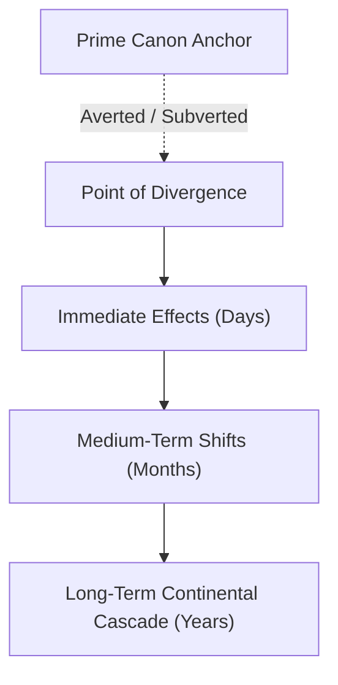

# <POD Short Title>

> [!NOTE]
> **Executive Summary:** <2-3 sentence technical overview of the Point of Divergence: the canonical anchor being altered, the primary causal agent, and the resulting systemic divergence across novel continuity.>

---

## 1. Causal Core & Divergence Thesis
<!-- 2 to 4 paragraphs establishing the exact historical pivot, motivation, and theoretical mechanism. -->

<Paragraph 1: The precise historical pivot point. Where and when does this divergence branch from the prime timeline? Who are the active agents present at the exact moment of branching?>

<Paragraph 2: The causal thesis and driving mechanism. Why did this outcome change? (e.g., Transmigrated foreknowledge preventing an impulsive error, manifestation of an anomalous innate power, refusal to enter an exploitative master-disciple contract, empirical intervention during a critical power source hunt).>

<Paragraph 3: Macro-thematic significance. How does this divergence alter the ideological or martial trajectory of the story? (e.g., Exposing theoretical flaws in established continental dogma, fracturing the monopoly of elite sects over commoner awakening, creating a multi-polar continental rivalry).>

- **Causal Invariant Statement:** `<"Because [Primary Action / Variable] occurred differently at [Timeline Node], [Systemic Consequence] inevitably follows under consistent world physics.">`

---

## 2. Original Canonical Baseline (Verbatim Evidence)
*Grounding in frozen canon sources (`01_Canon_and_Divergence/Sources/`) and Rule 30 literal quotes.*

- **Expected Canonical Sequence:** <Step-by-step description of what occurs in original <Setting Name> canon under `<CAN-Baseline_Reference>`.>
- **Canonical Quote / Evidence Anchor:**
  > *"<Literal quote or verified event citation from original source text demonstrating the baseline state.>"*
- **Baseline Entity Configurations:**
  - `<CHR-Original_Character_1>`: <Canon cultivation rank, psychological state, and equipment at this juncture.>
  - `<FAC-Original_Faction>`: <Canon posture, intelligence awareness, and geopolitical dominance.>

---

## 3. The Point of Divergence Mechanism
- **The Divergent Action / Anomaly:** <Detailed kinetic, dialogue, or metaphysical description of what actually happens in this timeline.>
- **Underlying Energetic / Biological Mechanics:** <How this divergence operates within <Setting Name> planar physics without relying on ungrounded plot armor (e.g., meridian heat dissipation, resonance frequency, genetic mutation laws).>
- **Immediate Sensory & Environmental Reaction:** <Shock of onlookers, atmospheric energy surges, or silent unnoticed deviation with delayed consequences.>

---

## 4. Causal Cascade & Butterfly Effect Matrix

### 4.1 Chronological Wave Progression
| Temporal Horizon | Direct Causal Consequence | Affected Factions / Characters | Ripple Severity |
|:---|:---|:---|:---:|
| **Immediate (Days)** | <Local outcome altered; duels won/lost; early registries recorded> | `<CHR-Actor_1>`, `<LOC-Local_Town>` | Tactical |
| **Medium-Term (Months)** | <Hunting forest discoveries, academic rankings, early intelligence leaks> | `<FAC-Regional_Branch>`, `<CHR-Allies>` | Institutional |
| **Long-Term (Years)** | <Continental tournament rosters altered, sect alliances shifted, god trial probes> | `<FAC-Imperial_Court>`, `<FAC-Orthodox_Hall>` | Continental |

### 4.2 Counterpart Adaptive Reactions (Non-NPC Dynamics)
- **Primary Antagonist Reaction:** <How Yu Xiaogang, <Dominant Hegemonic Faction>, or rival factions rationally react to the anomaly rather than acting blind.>
- **Protagonist Burden:** <Unintended complications, heightened scrutiny, or new enemies created as a direct result of changing history.>

---

## 5. Sanderson Hard Limits & Conservation of Plausibility
*Enforcing Rule 30 & Sanderson's Second Law: validating that the divergence adheres to causal realism.*

- **Conservation of Energy & Power Limits:** <Verification that characters did not break physiological cultivation caps; stamina and meridian backlash strictly enforced.>
- **No Free Telemetry:** <Characters who lacked information in canon still lack it unless given an empirical reason to investigate.>
- **Unintended Downstream Friction:** <Specific negative consequences or heightened dangers introduced because canon was disrupted.>

---

## 6. Negative Boundaries & Canonical Invariants
*Enforcing Rule 30: explicit documentation of what this POD DOES NOT change.*

1. **Negative Boundary 1 (Preserved Continental Realities):** <<Dominant Hegemonic Faction> STILL maintains overwhelming military dominance across the two empires; this POD does not weaken <Dominant Hegemonic Faction>'s existing Apex-Tier Practitioner elders.>
2. **Negative Boundary 2 (Unaltered Character Baselines):** <Characters not directly impacted by this divergence retain their canon innate powers, backgrounds, and personality flaws.>
3. **Negative Boundary 3 (Planar Laws Unbroken):** <Divine ascension STILL requires divine affinity and trial completion; zero instantaneous apotheosis.>
4. **Negative Boundary 4 (Sanderson Cost Floor):** <The protagonist CANNOT escape the ripple effects of their actions; every changed event forces recalculation and risk.>

---

## 7. Affected Story Bible Entities & Manuscript Hooks
- **Affected Character Dossiers:**
  - `<CHR-Protagonist>`: <Nature of divergence impact.>
  - `<CHR-Character_Name>`: <Shift in relationship, rival dynamic, or altered progression.>
- **Affected Factions & Systems:**
  - `<FAC-Orthodox_Hall>`: <Altered surveillance status.>
  - `<SYS-Power_System>`: <Governing threshold mechanics.>
- **Manuscript Chapters Deploying this POD:**
  - Initial Trigger: `<C01-Capitulo_pt-BR>` (Paragraphs `<!-- p:N -->`)
  - Downstream Payoffs: `<C##-Capitulo_pt-BR>`

---

## 8. Operational Lifecycle & Management Protocols

### 8.1 Inception Protocol (Phase 1)
1. **File Placement:** Always save under `01_Canon_and_Divergence/PODs/` with the exact filename `POD-<Number_or_Name>.md` (zero spaces, Rule 10).
2. **Metadata Integrity:** Fill YAML frontmatter completely (`uid`, `type: pod`, `chapter_trigger`, `diverged_from`, `causal_type`, `impact_tier`).
3. **Drafting Sequence:** Define Causal Core (Section 1) -> Baseline Quote (Section 2) -> Mechanism (Section 3) -> Butterfly Matrix (Section 4).

### 8.2 Scene Drafting & Continuity Verification (Phase 2)
1. **Prompt Integration:** Include relevant POD anchors in manuscript drafting prompts via `narr prompt render write-chapter`.
2. **Crosscheck Validation:** Run `narr crosscheck` to confirm no downstream manuscript chapters accidentally revert to prime canon behavior.

---

## 9. Standardized Lexicon & Taxonomy Glossary

| Term / Taxonomy | Category | Clear & Accessible Definition |
|:---|:---|:---|
| **Point of Divergence (*POD*)** | Canon | The root causal intervention that splits novel continuity from the original canonical timeline. |
| **Canonical Anchor** | Continuity | An immutable historical event or source text representing the prime universe baseline before divergence. |
| **Butterfly Cascade** | Timeline | The expanding exponential wave of secondary and tertiary consequences resulting from an initial divergence. |
| **Adaptive Intelligence** | Narrative | Ensuring established canon characters react logically and competitively to timeline changes rather than following script. |
| **Canonical Invariant** | Worldbuilding | Core planetary laws, geographical facts, and historical baselines that remain true across all timelines. |
| **Sanderson Limitation** | Power | Explicit physical or energetic ceiling preventing divergences from generating unearned or arbitrary power spikes. |
