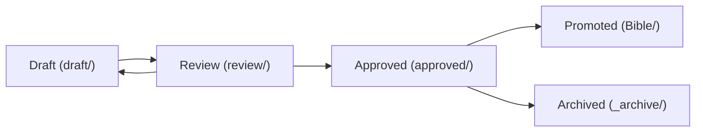

# 🔬 Sandbox / Laboratory — Creative Development Environment

> **The Upstream Staging Rule:** The Sandbox is an isolated creative laboratory **upstream** of the Story Bible. Ideas, power mechanics, and cosmology integrations mature here through research, brainstorming, deep analysis, and critic review before being promoted to `Bible/`.
> 
> **Epistemic Invariant:** The laboratory reads the vault; the vault NEVER depends on the laboratory. The vault never wikilinks into `Sandbox/` — cite sandbox projects as paths in `code` (for example `Sandbox/draft/SBX-001_Project_Name/spec.md`).

---

## 1. Lifecycle Phases

| Phase | Directory | Description |
|---|---|---|
| **Draft** | `Sandbox/draft/` | Active formulation: concept specs, mechanics brainstorming, trade-off analysis. |
| **Review** | `Sandbox/review/` | Under independent Critic evaluation against canon constraints and tone boundaries. |
| **Approved** | `Sandbox/approved/` | Critic passed, integrity checks passed — awaiting human authorization for promotion. |
| **Promoted** | `Bible/` | Promoted to the authoritative Bible as a formal `PWR_`, `TECH_`, `ITEM_`, or `DIV_` note. |
| **Archive** | `Sandbox/_archive/` | Retired, superseded, or historical working records. |

---

## 2. Governance Rules

1. **Not Canon Until Promoted:** Files in `Sandbox/` are speculative ideas; they do not enter writing context or bind the manuscript.
2. **Registry Primacy:** `Sandbox/_registry.md` is the single source of truth for all project statuses and phase transitions.
3. **No Dead Deletions:** Rejected or superseded concepts move to `_archive/` with tombstones explaining what was rejected and why.

