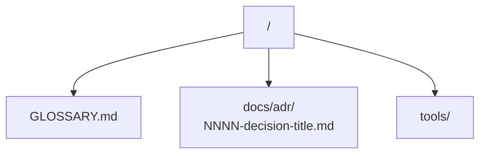

# Domain Docs

How the engineering skills should consume this repository's domain documentation when exploring the codebase.

## Before exploring, read these

- **`GLOSSARY.md`** at the repository root: defines the canonical domain vocabulary for the Multiverse Fanfiction Framework, the 3-Layer Vault architecture, the Ingestion Engine, and the Fiction-Conscious RAG (F-RAG).
- **`docs/agents/editorial-standards.md`**: defines the universal writing, formatting, epistemic rigor, and structural standards across all vault layers.
- **`docs/adr/`**: read Architectural Decision Records that touch the area you are about to work in.

If any of these files do not exist, proceed silently.

## File structure

Single-context repository layout:

## Use the glossary's vocabulary

When your output names a domain concept (in an issue title, a refactor proposal, a hypothesis, a test name), use the term as defined in `GLOSSARY.md`. Do not drift to synonyms the glossary explicitly avoids.

## Flag ADR conflicts

If your output contradicts an existing ADR, surface it explicitly rather than silently overriding:

> _Contradicts ADR-0001 (three-layer vault architecture), but worth reopening because…_

