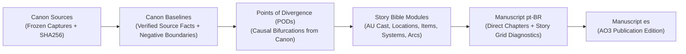

# Vault Editorial & Epistemic Standards

This document establishes the official writing, formatting, epistemic rigor, and structural standards for all directories across this narrative knowledge vault.

---

## 1. Universal Documentation Principles

All documentation outside `Manuscript/` must adhere to these non-negotiable principles:

1. **Official System Language (`en-US`):** All Story Bible entities, canonical baselines, timeline registers, architecture records, system configurations, and meta guides are authored strictly in American English (`en-US`). The **ONLY** exceptions are drafted narrative prose in `Manuscript/pt-BR/` (Portuguese) and publication chapters in `Manuscript/es/` (Spanish).
2. **High Information Density & Epistemic Honesty:** Notes must be substantive, precise, and direct. Avoid decorative filler, sycophantic roleplay, repetitive preambles, and speculative filler. Always distinguish between immutable source facts, canonical deductions, fanfiction points of divergence, and creative sandbox experiments.
3. **Single Source of Truth (SSOT) & Single-Link Baseline:** Facts are declared once in atomic canonical dossiers and referenced via `[[wikilinks]]`. AU dossiers in `Bible/` link to a single canonical baseline (`[[Canon/<Franchise>/Baselines/Baseline_<Topic>|Baseline - <Topic>]]`) and document only the AU divergence delta.
4. **Native Obsidian Mermaid Syntax:** All architectural flows, state machines, relationship matrices, and decision trees must use native Mermaid syntax (` ```mermaid `). Plaintext ASCII art diagrams are strictly prohibited.
5. **Zero-Space & Semantic Filename Invariant:** All filenames must contain zero spaces, using standard prefixes (`Baseline_`, `DIV_`, `LOC_`, `ITEM_`, `PWR_`, `TECH_`, `REL_`, `ARC_`, `PT_Chapter_`, `ES_Chapter_`).

---

## 2. Layer-by-Layer Writing Matrix

| Directory / Layer | Language | Tone & Density | Mandatory Structure | Evidence & Citation | Anti-Patterns (Prohibited) |
|---|---|---|---|---|---|
| **`00_Cockpit/`** | `en-US` | High density, diagnostic | Frontmatter, Dataview queries, Bases, navigation links | Dynamic Dataview queries over vault layers | Hardcoded outdated tables, speculative narrative text |
| **`Canon/*/Sources/`** | Original | Frozen raw text | Unmodified captures with cryptographic JSON sidecars (SHA-256) | Verbatim source captures | Any manual edits, translations, or lossy alterations |
| **`Canon/*/Baselines/`** | `en-US` | Atomic, objective, legalistic | Summary, Source-backed details, Negative boundaries, Sources and scope | Direct links to `Canon/*/Sources/` with SHA-256 validation | Speculative fanon assumptions, fanfiction AU alterations |
| **`Bible/01_Divergences_AU/`** | `en-US` | Analytical, causal | Divergence Decision, Established Changes, Chronology & Continuity | Explicit wikilinks to `Canon/*/Baselines/` | Arbitrary plot shifts without causal rationale |
| **`Bible/02_Cast_Characters/`** | `en-US` | Encyclopedic, in-universe | Identity & Canon Delta, Voice Guide, Abilities, Strategic Assets, Relationships | Links to `Canon` baselines & `DIV` PODs | Power-scaling bloat, unanchored stat sheets |
| **`Bible/03..10/`** | `en-US` | Encyclopedic, structural | System Overview, Taxonomy, Mechanics, Narrative Role | Links to owning baselines and PODs | Unverified crossover hand-waving without cost/fatigue laws |
| **`Ledgers/LDG-Contradictions.md`** | `en-US` | Concise, tabular, auditable | Date, Dispute, Side A (quote), Side B (quote), Status, Resolution | Exact locators and quotations | Silent resolution by agents without authorial ratification |
| **`Manuscript/pt-BR/`** | `pt-BR` | Literary, dramatic, somatic | Chapter frontmatter, Dialogue conventions, Narrative prose, Story Grid audit notes | Governed by Story Bible continuity | Direct chapter subfolder nesting, English terms in dialogue |
| **`Manuscript/es/`** | `es` | Literary, faithful adaptation | Matching pt-BR scene structure, `pt_source_chapter` link | 1:1 fidelity with pt-BR master draft | Glossary drift, scene invention, broken wikilinks |
| **`Sandbox/`** | `en-US` | Exploratory, analytical | Brainstorming concepts, staging lab shelves, research notes | Experimental cross-vault references | Direct inclusion in production RAG before formal promotion |
| **`99_System/`** | `en-US` | Technical, deterministic | Templates, Export procedures, Lexicon registers, franchise rules | Adherence to validator schemas | Lore fabrication in operational configs |

---

## 3. Epistemic Traceability Chain

Information progresses strictly downstream through four verifiable tiers:



- **Canon Baseline Invariant:** Pure source facts only. Must state both positive facts and negative boundaries ("what it does NOT establish").
- **AU Divergence Invariant:** The Story Bible is authoritative for this work. Points of Divergence supersede Canon.
- **Single-Link Provenance Invariant:** An AU Bible entity links to exactly ONE canonical baseline and documents only the divergence delta.
- **Sandbox Isolation Invariant:** The `Seeds_Scratchpad/` incubator is an upstream staging lab. Notes there do not enter production writing context until formally promoted to `Canon/` and `Bible/`.

---

## 4. Narrative Craft & Somatic Grounding

When drafting or evaluating narrative prose in `Manuscript/`:

1. **Somatic Grounding over Abstract Power:** Characters interact with physical reality through concrete physiological mechanisms: center of gravity, tendon tension, arterial pulse, diaphragmatic breath regulation, and kinetic recoil. Combat must never degenerate into abstract energy blasts; vector lines, friction, terrain deformities, and metabolic heat must be described.
2. **Aesthetic Framing (Earned Labor vs. Hereditary Arrogance):** Emphasize the physical reality of deliberate discipline: widened energy pathway channels, calloused hands, laminar channel control, and crucible patience. Depict inherited entitlement and bureaucratic cruelty as structurally brittle.
3. **Dual-Language Dialogue Integrity:** Prose drafts in Portuguese and translations in Spanish must strictly follow the character voice guides in `Bible/02_Cast_Characters/*_AU.md` and the bilingual register in `99_System/Lexicon_PT_ES/`.

