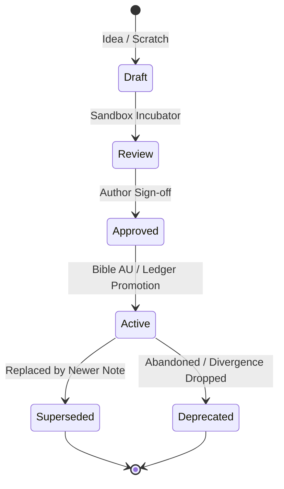

# Standardized Narrative Information Architecture (SNIA)

This specification defines the structural organization, naming conventions, metadata schemas, tagging taxonomy, and information lifecycles for the **Narrative Vault Framework**.

---

## 1. Epistemic Core Principles

1. **Every Fact Has One Home:**
   *Every fact has one home: the layer whose job it is; elsewhere, link there.*
   A note should never copy lore, mechanics, or character bios from another layer. Summarize in one sentence and link to the authoritative source note.

2. **Single-Link Baseline Provenance:**
   Bible AU dossiers must link back to their canonical baseline dossier (`[[Canon/<Franchise>/Baselines/Baseline_<Topic>|Baseline - <Topic>]]`) and document only the AU divergence delta. Do not scatter citations across raw wiki captures.

3. **AU Divergence Precedence (F-RAG Rule):**
   In drafting and retrieval, Points of Divergence (`Bible/01_Divergences_AU/`) take absolute precedence over Canon baselines. AU ground truth always overrides external franchise lore.

4. **Non-Destructive Sourcing & History:**
   Raw captures in `Canon/*/Sources/` are cryptographically frozen with SHA256 sidecars. Manuscript prose is never overwritten destructively. Outdated notes are deprecated or superseded, never silently erased.

5. **Zero-CJK Policy:**
   Outside immutable source captures in `Canon/*/Sources/`, all live vault files prohibit Hanzi/Kanji characters. Romanize all Japanese, Chinese, or foreign terms with italics (for example Hepburn or Pinyin forms set in italics).

6. **Authoritative Timeline Alignment:**
   The master chronological measuring system is declared in `vault.yaml` (`story.epoch`, `story.authoritative_calendar`) and counted strictly forward from that epoch.

---

## 2. Vault Layer Ownership & Boundaries

| Layer / Directory | The Fact It Owns | What Does NOT Belong Here |
|---|---|---|
| `00_Cockpit/` | Author flight control: master dashboards, Bases tables, high-level project vitals. | Detailed lore, drafting prose, canonical baselines. |
| `Canon/<Franchise>/Sources/` | Frozen, immutable source wiki captures and cryptographic SHA256 JSON sidecars. | Synthesized baselines, AU modifications, author commentary. |
| `Canon/<Franchise>/Baselines/` | Consolidated, franchise-specific canonical ground truth dossiers. | AU divergences, fanfiction mechanics, speculative plot. |
| `Bible/` (10 Modules) | The alternate universe (AU) ground truth: deltas, OC cast, mechanics, timeline. | Canonical baseline restatements, drafting prose, raw wiki text. |
| `Manuscript/pt-BR/` | Master drafting language chapters with Story Grid scene diagnostic markers. | Final translated publication prose, lore notes, AU dossiers. |
| `Manuscript/es/` | Publication language chapters ready for AO3 export. | Raw drafting notes, untranslated Portuguese, author commentary. |
| `Ledgers/` | Append-only continuity ledgers: Chekhov items, open threads, contradictions, decisions. | Active drafting prose, canonical source lore, mutable scratchpads. |
| `Sandbox/` | Upstream creative incubator laboratory (`_registry.md`, `draft/`, `review/`, `approved/`). | Canon facts (not canon until promoted to Bible); no vault note links into Sandbox. |
| `Craft/` | Narrative diagnostics, scene surgery rubrics, critique reports, and audit findings. | In-universe lore, character dossiers, unreferenced opinions. |
| `Research/` | Real-world metallurgical, physics, historical, and mythological references. | Fictional AU power systems, fanfiction prose, canon wiki scrapes. |
| `context/` | Author voice, narrative perspective, register, rhythm, and bilingual translation rules. | Session-specific notes, in-flight chapter state, lore dossiers. |
| `memory/` | Cognitive harness: in-flight active state (`hot.md`), durable learnings, journal logs. | Rules (belong in `AGENTS.md` or `docs/`), permanent lore, drafting text. |
| `eval/` | Golden retrieval evaluation benchmark (`queries.yaml`, `baseline.json`). | Application code, lore files, prompt scratchpads. |
| `99_System/` | Reusable Markdown templates, bilingual dictionaries, and system routing configs. | Live notes, lore dossiers, creative prose. |

---

## 3. Canonical Entity Identifiers (UIDs) & Filename Rules

Every first-class entity in the vault carries a canonical Unique Identifier (`uid`) in its YAML frontmatter.

### UID Prefix Taxonomy

| Prefix | Domain / Entity Type | Target Directory | Example UID | Example Note Name |
|---|---|---|---|---|
| `CKP-` | Cockpit Dashboard / Atlas | `00_Cockpit/` | `CKP-HOME-DASHBOARD` | `00_Home_Dashboard.md` |
| `BIB-` | Bible Master Index / Register | `Bible/` | `BIB-MASTER-INDEX` | `00_Bible_Master_Index.md` |
| `CAN-` | Canon Baseline Dossier | `Canon/<Franchise>/Baselines/` | `CAN-ALP-MASTER-CHRONO` | `Baseline_Master_Chronology_Timeline.md` |
| `SRC-` | Raw Sourced Capture | `Canon/<Franchise>/Sources/` | `SRC-ALP-CORE-WIKI` | `Alpha_Fandom_Core.md` |
| `DIV-` | Point of Divergence | `Bible/01_Divergences_AU/` | `DIV-001-PROTAGONIST-ARRIVAL` | `DIV_001_Protagonist_Arrival.md` |
| `CHR-` | Cast Character Profile | `Bible/02_Cast_Characters/` | `CHR-PROTAGONIST` | `Protagonist_AU.md` |
| `FAC-` | Faction / Organization | `Bible/03_Factions_Organizations/` | `FAC-ALPHA-COUNCIL` | `FAC_Alpha_Council_AU.md` |
| `LOC-` | Location / Setting | `Bible/04_Locations/` | `LOC-ALPHA-ACADEMY` | `LOC_Alpha_Academy_AU.md` |
| `ITM-` | Item / Weapon / Artifact | `Bible/05_Items_Artifacts/` | `ITM-AETHER-ARMOR` | `ITEM_Aether_Armor_AU.md` |
| `PWR-` | Power System / Energy Law | `Bible/06_Power_Systems_Mechanics/` | `PWR-AETHER-FOUNDATIONS` | `PWR_Aether_AU.md` |
| `TEC-` | Technique / Skill | `Bible/06_Power_Systems_Mechanics/` | `TEC-SPIRAL-VARIANT` | `TECH_Spiral_AU.md` |
| `REL-` | Relationship Matrix | `Bible/07_Relationship_Matrix/` | `REL-ALPHA-BETA` | `REL_Alpha_Beta.md` |
| `TML-` | Timeline / Chronology Event | `Bible/08_Chronology_Calendar/` | `TML-Y26-ACADEMY-ENTRY` | `TML_Y26_Academy_Entry.md` |
| `ARC-` | Narrative Arc / Plot Thread | `Bible/09_Plot_Threads_Arcs/` | `ARC-01-OPENING-DAYS` | `ARC_01_Opening_Days.md` |
| `TRM-` | Terminology / Nomenclature | `Bible/10_Terminology_Glossary/` | `TRM-AETHER-TERMS` | `TRM_Aether_Terminology.md` |
| `LDG-` | Continuity Ledger | `Ledgers/` | `LDG-CHEKHOV` | `LDG-Chekhov.md` |
| `SBX-` | Sandbox Staging Project | `Sandbox/<Stage>/` | `SBX-001-ENGINE-LAB` | `SBX-001_Engine_Lab.md` |
| `CRT-` | Craft Critique Report | `Craft/Critiques/` | `CRT-CH01-OPENING` | `CRT_CH01_Hook_Diagnostic.md` |
| `AUD-` | Narrative Architecture Audit | `Craft/Audits/` | `AUD-ACT1-CAUSALITY` | `AUD_Act1_Causal_Chain.md` |
| `RES-` | Research Reference Note | `Research/Notes/` | `RES-METALLURGY-ARMOR` | `RES_Weaponry_Metallurgy.md` |
| `CTX-` | Cognitive Context Note | `context/` | `CTX-AUTHOR` | `author.md` |
| `MEM-` | Cognitive Memory Note | `memory/` | `MEM-HOT` | `hot.md` |
| `MSP-` | Manuscript Draft / Index | `Manuscript/<lang>/` | `MSP-PT-INDEX` | `Index.md` |
| `SYS-` | System Lexicon / Procedure | `99_System/` | `SYS-GLOSSARY-PT-ES` | `Glossary_Terms_PT_ES.md` |
| `TPL-` | System Template | `99_System/Templates/` | `TPL-CANON-BASELINE` | `TPL_Canon_Baseline.md` |

### Filename Rules
1. **Preserve Existing Wikilinks:** Do not alter established file names that have incoming wikilinks unless executing an explicit, repo-wide link migration. UIDs live in frontmatter and are listed in `aliases`.
2. **Filesystem Safety:** All note names and identifiers must be alphanumeric with underscores or hyphens. No spaces, colons (`:`), pipes (`|`), slashes (`/`, `\`), quotes, or non-ASCII characters.

---

## 4. Frontmatter Properties Schema (Obsidian 1.4+ Aligned)

All live vault notes must provide a valid YAML frontmatter block adhering to Obsidian Properties standards.

### Core Universal Properties

```yaml
---
note_type: <registered-type>   # String from registered schema or UNSCHEMED_NOTE_TYPES
title: <Descriptive Title>     # Full human-readable title
status: <lifecycle-status>     # draft | active | canonical | superseded | deprecated
aliases:
  - <Alternative Name>
  - <Canonical UID>
tags:
  - <#namespace/subvalue>
uid: <CANONICAL-UID>
created: YYYY-MM-DD
updated: YYYY-MM-DD
---
```

### Domain-Specific Extension Properties
- **Canon Baselines (`note_type: canon-baseline`):** `franchise: string`, `canon_tier: string`, `primary_sources: list`.
- **Bible AU Cast (`note_type: character-profile`):** `cosmology: string`, `generation: string`, `birth_year: int`, `canonical_baseline: string`.
- **Bible AU Divergences (`note_type: pod`):** `divergence_point: string`, `affected_modules: list`, `anchor_year: string`.
- **Continuity Ledgers (`note_type: ledger`):** `ledger_type: chekhov | decisions | threads | contradictions | handoff`.
- **Sandbox Incubator (`note_type: sandbox-project`):** `stage: draft | review | approved | archive`, `target_module: string`.

---

## 5. Hierarchical Tag Taxonomy

Tags provide associative categorization that cuts across folders. SNIA mandates lowercase hierarchical tags structured as `#namespace/subvalue`.

### Approved Tag Namespaces

| Namespace | Intended Use | Valid Subvalues (Examples) |
|---|---|---|
| `#canon/` | Canonical reference scope | `#canon/universe-primary`, `#canon/universe-secondary` |
| `#bible/` | AU ground truth modules | `#bible/character`, `#bible/divergence`, `#bible/power-system`, `#bible/location`, `#bible/faction`, `#bible/timeline` |
| `#ledger/` | Narrative continuity ledgers | `#ledger/chekhov`, `#ledger/decisions`, `#ledger/threads`, `#ledger/contradictions` |
| `#sandbox/` | Creative incubator stages | `#sandbox/draft`, `#sandbox/review`, `#sandbox/approved`, `#sandbox/archive` |
| `#craft/` | Narrative technique & audit | `#craft/guide`, `#craft/critique`, `#craft/audit`, `#craft/story-grid` |
| `#research/` | Real-world & external research | `#research/metallurgy`, `#research/mythology`, `#research/physics` |
| `#context/` | Authorial & linguistic harness | `#context/author-voice`, `#context/language-rules` |
| `#memory/` | Cognitive harness memory | `#memory/hot`, `#memory/learning`, `#memory/journal` |
| `#cockpit/` | Author flight control & diagnostic dashboards | `#cockpit/dashboard`, `#cockpit/audit` |
| `#manuscript/` | Story prose drafts & translation chapters | `#manuscript/pt-br`, `#manuscript/es` |
| `#system/` | System configurations, lexicons & exports | `#system/lexicon`, `#system/export`, `#system/procedure` |

### Tag Invariants & Anti-Duplication Rule
- **Never tag what frontmatter carries:** Do NOT create tags like `#status/canonical` or `#type/baseline` when `status` and `note_type` exist in frontmatter.
- **Strictly Lowercase:** All tag slugs must use lowercase letters, digits, and hyphens (e.g. `#bible/power-system`, not `#Bible/PowerSystem`).
- **Zero-CJK Policy:** Tag slugs must never contain Chinese/Japanese characters.

---

## 6. Navigation Architecture & Maps of Content (MOCs)

Navigation follows the LYT (Linking Your Thinking) Map of Content model:

1. **Vault Master Atlas (`00_Cockpit/00_Home_Dashboard.md`):** Top-level navigation flight deck linking to all domain MOCs, system status, and translation pipelines.
2. **Domain MOCs:**
   - `Bible/00_Bible_Master_Index.md` (Story Bible MOC covering all 10 modules)
   - `Canon/<Franchise>/00_<Franchise>_Index.md` (one Canon index per source universe)
   - `Ledgers/IDX-Ledgers.md` (Continuity Ledgers index)
   - `Sandbox/_registry.md` & `Sandbox/README.md` (Sandbox incubator master index)
   - `Craft/README.md` (Narrative Craft index)
   - `Research/README.md` (Research reference index)
3. **Tabular Standard:** All MOC tables must contain standard columns:
   `| UID | Entity / Note | Category / Module | Status | Summary |`
4. **Bidirectional Links:** Every note in a domain should link back to its domain MOC or parent baseline.

---

## 7. Information Lifecycle & Deprecation Policy

Information in the vault moves through a defined lifecycle.



### Retirement & Supersession Protocol
1. **Never Silently Delete:** Notes that were once part of the story or canon baseline must never be deleted without an explicit audit trail.
2. **Superseded Notes:**
   - Set `status: superseded` in YAML frontmatter.
   - Add `superseded_by: "[[Target_Note]]"`.
   - Add a notice callout at the top of the note:
     > [!WARNING] Superseded Document
     > This document has been superseded by [[Target_Note]]. Do not edit or cite as active canon.
3. **Deprecated Notes:**
   - Set `status: deprecated`.
   - Add `deprecation_reason: "<explanation>"`.

