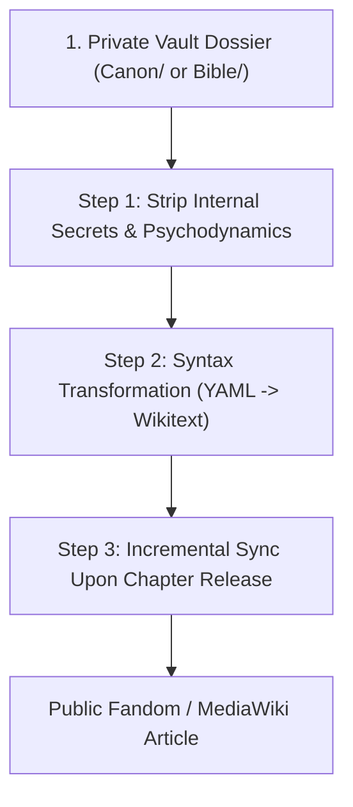

# FANDOM_EXPORT_GUIDE.md — Public Wiki Export & Sanitization Protocol

This guide establishes the authoritative standard for bridging the private authorial knowledge vault (Obsidian Markdown) with a public reader-facing wiki (Fandom or MediaWiki), guaranteeing that public documentation remains professional, structured, and free of accidental plot spoilers.

---

## 1. Architectural Separation: Private Vault vs. Public Wiki

| Dimension | Private Obsidian Vault (`Canon/` & `Bible/`) | Public Fandom / MediaWiki (`Wiki/`) |
| :--- | :--- | :--- |
| **Audience** | Human Author & AI Co-author Agents | Readers, Community, Fans |
| **Purpose** | Dramaturgical planning, continuity control, unreleased secrets | Encyclopedic reference of verified published facts |
| **Format** | Flat YAML frontmatter + Markdown + Dataview queries | Portable Infobox XML + Wikitext articles |
| **Scope** | Complete multiverse timeline, future twists, character psychology | Released chapters ONLY; zero unverified speculation |

---

## 2. The 3-Step Sanitization & Publishing Pipeline

### Step 1: Strip Internal Secrets & Psychodynamics
- **Psychodynamic Fields:** Private dramatic drivers—such as *The Wound*, *The Lie*, *Want*, *Need*, and *Internal Arc Trajectories*—must **NEVER** be exported to public articles.
- **Unreleased Plot Twists & PODs:** Future Alternate Universe divergences and upcoming incursion catalysts remain strictly confined to `Bible/01_Divergences_AU/` until the corresponding chapter is officially published.
- **Secret Alignments & Treasons:** A character's public alignment and faction affiliation must reflect their status as perceived by the readership at the current chapter milestone.

### Step 2: Syntax Transformation & Field Mapping
- **Key Naming Convention:** Flat YAML in the vault uses lowercase hyphens or underscores (`status`, `first_appearance`), whereas Wikitext infoboxes use snake_case parameters (`first_appearance = ...`).
- **Lists to Bullets:** Convert YAML array sequences into standard Wikitext bullet points (`* [[Entity]]`).
- **Wikilinks Preservation:** Wikilinks (`[[Page Name]]` or `[[Target|Alias]]`) are preserved across both Obsidian and MediaWiki.

| Vault Property | Wikitext Parameter | Example Transformation |
| :--- | :--- | :--- |
| `title` / file name | `name` / `title` | `name = Character Name` |
| `aliases` | `alias` | `alias = The Shadow Blade` |
| `cosmology` | `cosmology` | `cosmology = Universe_Primary` |
| `status` | `status` | `status = Alive` |
| `affiliation` | `affiliation` | `affiliation = [[Hidden Leaf Village]]` |
| `relatives` / `allies` | `relatives` / `allies` | `* [[Character A]]\n* [[Character B]]` |
| `first_appearance` | `first_appearance` | `first_appearance = [[Chapter 01: Awakening]]` |

### Step 3: Incremental Synchronization Post-Release
- Following the publication of each new chapter on AO3 / public hosts:
  1. Update vital statuses of characters who fell in battle (`status: Deceased`).
  2. Append newly introduced items, techniques, and locations to their respective public categories.
  3. Update `last_appearance` parameters on affected character infoboxes.

---

## 3. Portable Infobox XML Deployment

Deploy the XML schemas located in `99_System/Export_Templates/Fandom/` directly into the MediaWiki / Fandom template namespace:

1. **Character Infobox:** `99_System/Export_Templates/Fandom/Infobox_character.xml` → Deploy to `Template:Infobox_character`.
2. **Location Infobox:** `99_System/Export_Templates/Fandom/Infobox_location.xml` → Deploy to `Template:Infobox_location`.
3. **Organization Infobox:** `99_System/Export_Templates/Fandom/Infobox_organization.xml` → Deploy to `Template:Infobox_organization`.
4. **Item Infobox:** `99_System/Export_Templates/Fandom/Infobox_item.xml` → Deploy to `Template:Infobox_item`.

Each template includes responsive mobile support, dynamic field suppression (omitted parameters automatically collapse), and clean theme integration.

---

## 4. Editorial Governance: Anti-Speculation & Retcon Policy

### 4.1 Anti-Speculation Rule
- Public wiki articles represent in-universe encyclopedic authority.
- Reader fan theories, speculative ship discussions, and power scaling debates must **not** be placed in main article bodies or infoboxes.
- If speculative commentary is preserved, it must be restricted to a designated `== Trivia & Notes ==` section with an explicit disclaimer.

### 4.2 Retcon Management
- When a canon divergence or authorial retcon occurs between earlier and later chapters:
  - Document the evolution chronologically with neutral in-universe attribution (e.g., *"Prior to Chapter 14, the artifact was believed to originate from... however, revelations in Chapter 28 established that..."*).
  - Never silently delete or overwrite historical continuity without contextualizing the narrative progression.

