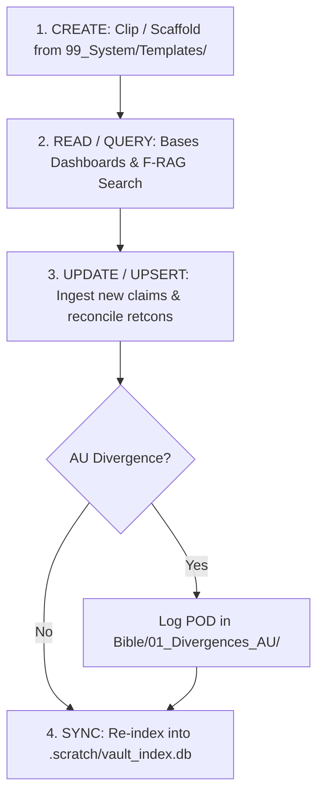

# MANUAL_OF_STYLE.md — Vault Documentation & Wiki Template Standards

This document is the authoritative style guide, structural specification, and operational lifecycle standard for all documentation, wiki templates, and lore dossiers in this repository.

---

## 1. Scope & Purpose

This framework serves a **dual-surface architecture**:
1. **Human Authors in Obsidian:** Visual dashboards, interactive Bases (`.base`), dynamic Dataview queries, graph view clusters, and navigable wikilinks.
2. **AI Coding & Writing Agents:** Deterministic CLI toolchain, offline SQLite FTS5 search, strict schema validation, and Fiction-Conscious RAG (F-RAG) context assembly.

To maintain perfect harmony between human navigation and AI context ingestion, all files (with the sole exception of prose in `Manuscript/`) must strictly adhere to the standards outlined in this manual.

---

## 2. Voice, Tone & Information Density

### 2.1 The Canon Layer (`Canon/`): In-Universe Clinical Detachment
All canonical dossiers must be written in an **objective, in-universe archival tone**, modeled after premier reference archives such as the *SCP Foundation*, *Wookieepedia*, and *The Coppermind*:
- **In-Universe Perspective:** Treat the fictional reality as an established, palpable universe. Describe entities, phenomena, and historical occurrences as documented facts.
- **Detached Clinical Prose:** Avoid emotional hyperbole, conversational fillers, or subjective authorial judgments (e.g., write *"The entity demonstrates high thermal conductivity and instantaneous directional redirection"* rather than *"This awesome character has super cool overpowered fire moves"*).
- **Prohibition of Meta-Commentary:** Do not include real-world author opinions, studio rumors, or narrative commentary in the main body.
- **Tense Discipline:**
  - **Present Tense (`is`, `demonstrates`, `possesses`):** Used for enduring physical laws, geographical features, static mechanics, and active biological attributes.
  - **Past Tense (`was`, `founded`, `diverged`):** Used strictly for completed historical milestones, battles, deceased entities, or superseded eras.
- **Information Density:** Prioritize structured markdown tables, bulleted technical claims, and clear definition paragraphs over rambling narrative prose.

### 2.2 The Bible Layer (`Bible/`): Operational Ground Truth
The Bible layer documents the fanfiction's **alternate-universe (AU) reality**:
- **Operational Reality:** Documents changes resulting from Points of Divergence (PODs).
- **Explicit AU Alerts:** Every file modifying canon must feature the standardized alert block:
  ```markdown
  > [!WARNING] **AU OVERRIDE: SUPERCEDES CANON**
  > The following events establish the primary bifurcation from official canon.
  ```
- **Dual Voice Guidelines:** Character profiles in the Bible document specific voice nuances for master drafting in Portuguese (`pt-BR`) and publication in Spanish (`es`).

---

## 3. Modular Delegation Protocol (The Coppermind Rule)

To prevent hyper-fragmentation and context window exhaustion:
1. **No Monolithic Rule Duplication:** A character profile or location dossier must **never** duplicate the exhaustive mechanics of an entire power system or item.
2. **Summary + Wikilink:** Provide a functional 1–2 sentence summary of how the specific entity interacts with the system, followed by an explicit wikilink to the canonical modular dossier (e.g., `[[Dossier_Power_System_Template]]`).
3. **The 3-Pillars Evaluation:** An entity earns a dedicated modular dossier if and only if it meets all three criteria:
   - Possesses its own distinct invariant rules.
   - Has a defined progression scale or hierarchical tiers.
   - Is reusable across multiple narrative arcs or characters.

---

## 4. Frontmatter Schema Standards (Dual Surface)

Every markdown dossier in the vault must declare a YAML frontmatter block compatible with both Obsidian native Properties / Dataview / Bases and the Node.js F-RAG indexer:

```yaml
---
# Dual-surface classification
note_type: "canon-character"      # For Obsidian Bases (.base) queries
type: "character"                 # For F-RAG SQLite FTS5 categorization

# Universe & Provenance
cosmology: "Universe_Primary"     # Matching Canon/<Cosmology> or "Shared"
canon_tier: "G-Primary"           # G-Primary, C-Secondary, W-Author-WoB, or AU-Override
aliases:
  - "Primary Alias"
  - "Secondary Title"

# Status & Relations
status: "Active"                  # Active, Deceased, Dormant, Unprocessed, Archived
tags:
  - "canon"
  - "character"
---
```

### Mandatory Field Definitions
- `note_type`: Categorical string matching Obsidian Base filters (`canon-character`, `canon-location`, `canon-power-system`, `canon-faction`, `canon-item`, `canon-event`, `canon-source`, `fic-pod`, `fic-cast`, `fic-matrix`, `fic-world`, `fic-arc`, `scene-pt`, `chapter-es`).
- `type`: High-level category string for F-RAG domain routing (`character`, `location`, `power_system`, `faction`, `item`, `timeline_event`, `source`, `divergence_pod`, `cast_profile`, `relationship_matrix`, `world_delta`, `narrative_arc`).
- `cosmology`: Canonical franchise name matching folder under `Canon/` (e.g. `Universe_Primary`, `Universe_Secondary`) or `Shared` for cross-cosmology Bible notes.
- `canon_tier`: Hierarchy weight (`G-Primary` for core canon, `C-Secondary` for spinoffs, `W-Author-WoB` for author statements, `AU-Override` for fanfiction Bible).
- `aliases`: List of alternative names, localized titles, or transliterations used by search indexing.

---

## 5. CRUD Lifecycle Operations



### 5.1 Create (Scaffolding New Dossiers)
- When capturing external lore: Use `npm run clip -- <url>` to ingest into `Canon/<Cosmology>/00_Sources/`.
- When creating a manual dossier: Copy the corresponding template from `99_System/Templates/`, place it in the appropriate numbered directory under `Canon/<Cosmology>/` or `Bible/`, and populate the frontmatter properties.
- **Naming Convention:** PascalCase with underscores (e.g., `Character_Name.md`, `Dossier_Energy_System.md`, `DIV_01_Incursion_Title.md`).

### 5.2 Read & Query
- **Obsidian Visual Views:** Dashboards in `00_Cockpit/` automatically pull dossiers using `.base` cards filtered by `note_type` and `cosmology`.
- **AI Agent Retrieval:** Query dossiers via FTS5 BM25 search (`npm run rag:search -- "<query>"`) or assemble hierarchical context for drafting (`npm run rag:context -- "<prompt>"`).

### 5.3 Update & Upsert (Continuous Ingestion)
- When official canon updates or new episodes release, clip the updated source and run `npm run ingest -- <path>`.
- Ingestor synthesizes new atomic claims into existing dossiers under `## 5. Record of Divergences, Retcons, and Edge Cases`.
- Existing definitions and core laws are preserved; verified sources are appended to the metadata table.

### 5.4 Deprecate, Archive & Divergence Precedence
- **Non-Destructive Sourcing Rule:** Never delete or destructively rewrite canonical source files in `Sources/` or original drafts.
- **Canon Supercession (AU Precedence):** When fanfiction events diverge from canon, do **not** edit the canonical dossier in `Canon/`. Instead, create or update a Point of Divergence in `Bible/01_Divergences_AU/` and an operational cast sheet in `Bible/02_Cast_Characters/`.
- **Archiving Deprecated Notes:** Notes that become obsolete during drafting are moved to `Manuscript/pt-BR/03_Scrapyard/` or marked with frontmatter `status: "Archived"`.

---

## 6. Manuscript Formatting & Dialogue Conventions

To guarantee consistency across human writing, AI-assisted drafting, and public exports (e.g. AO3, Fanfiction.net):

### 6.1 Mandatory Chapter Opening Header
Every fanfiction chapter (in compiled Portuguese master and working/published Spanish translations) must commence with the following standard block immediately following the title or chapter banner:

```markdown
## Chapter NN: Title

**All rights to their respective authors***

**"Dialogue":** Represented in double quotes for conversations between characters.

**'Thoughts':** Represented in single quotation marks, indicating the characters' internal reflections.

---
```

### 6.2 Dialogue and Internal Monologue Conventions
- **Spoken Dialogue (`"..."`):** Must always be enclosed in standard double quotes.
- **Internal Reflection & Thoughts (`'...'`):** Must always be enclosed in single quotation marks.
- **No Em-Dash Dialogue Punctuation for Web-Published Chapters:** Double quotes are the universal standard across international fanfiction platforms (AO3, FFN, SpaceBattles), ensuring clean rendering across mobile and desktop environments.

---

## 7. Multiverse Character Sheet & Power Scaling Architecture

Multiverse and crossover fanfiction requires nuanced character documentation capable of balancing diverse cosmology rulebooks without lore corruption:

### 7.1 Dual-Surface Character Profile Separation
- **Canonical Character Dossier (`Canon/<Cosmology>/01_Characters/`):** Strictly limited to official source material. Written in an objective, clinical archival voice. Features an in-universe parameter matrix (Physical Strength, Durability, Speed, Energy Reserves, Intellect, Effective Range).
- **Alternate-Universe Cast Profile (`Bible/02_Cast_Characters/`):** Operational ground truth for the fanfiction. Documents multiversal progression, crossover energy synergy, AU psychodynamics, and dimensional age differences.

### 7.2 Multiversal Energy System Synergy & Bottlenecks
- When a character commands multiple energy disciplines (e.g. Chakra, Senjutsu, Touki, Haki, Sacred Gears, Magic, Ki, Magecraft):
  - Every secondary system must declare its compatibility rules and somatic costs.
  - Characters must not be granted omnipotent free energy; internal conversion reactors, stamina drains, and cultivation bottlenecks must be strictly respected.

### 7.3 Dual-Tier Power Scaling (Keys & Transformations)
- Power scaling must document baseline performance versus transformed or equipped states:
  - **Base Form:** Standard operating state with indefinite stamina stability.
  - **Awakened / Transformed State:** Elevated combat multipliers (e.g., Balance Breaker, Sage Mode, Devil Form, Super Saiyan) with defined time windows and energetic strain.
  - **Maximum Overdrive:** High-risk output pushing existential boundaries.

### 7.4 Multicross Resistance & Immunity Matrix
- Combat encounters across cosmologies require explicit resistance tracking:
  - Physical Kinetic & Impact
  - Magical & Elemental
  - Soul & Spiritual Intrusion
  - Mental & Cognitive Manipulation (e.g. Gamer's Mind immunity)
  - Curse, Miasma & Poison
  - Spatial & Temporal Distortion
  - Conceptual & Instant Erasure

### 7.5 Modular LitRPG / Gamer System Block
- For stories featuring Gamer systems or LitRPG progression, the modular status interface in `TPL_Bible_Cast_Profile.md` organizes:
  - Vital parameters (HP and MP with recovery rates).
  - Core RPG attributes (STR, VIT, INT, DEX, LUCK).
  - Job/Class progression and history.
  - Categorized skill registry (Passive, Active, and Unique skills with rarities, levels, and mana costs).

### 7.6 Visual Identity Integration (`art-concept` Skill)
- All cast profiles should define visual identity pillars and a standardized 5-pillar master prompt matching `.agents/skills/art-concept/SKILL.md`:
  - `[Subject & Action]`
  - `[Costume & Armor]`
  - `[Aura & Manifestation]`
  - `[Environment & Lighting]`
  - `[Style & Technical]` + Standard Negative Prompts

---

## 8. Template Suite Directory Map

```text
99_System/Templates/
├── TPL_Canon_Character.md          # Canon: Individual biographical dossier
├── TPL_Canon_Location.md           # Canon: Planet, realm, city, or geography
├── TPL_Canon_Power_System.md       # Canon: Magic, energy, and progression laws
├── TPL_Canon_Faction_Org.md        # Canon: Guild, military sect, clan, or faction
├── TPL_Canon_Item_Artifact.md      # Canon: Weapon, relic, or technological device
├── TPL_Canon_Event_Timeline.md     # Canon: Historical battle, treaty, or era
├── TPL_Bible_Divergence_POD.md     # Bible: Point of Divergence (AU Override)
├── TPL_Bible_Cast_Profile.md       # Bible: Fanfiction cast profile & voice delta
├── TPL_Bible_Relationship_Matrix.md# Bible: Dynamic inter-character matrix
├── TPL_Bible_World_Delta.md        # Bible: Alternate universe world & location shift
└── TPL_Bible_Plot_Arc.md           # Bible: Narrative arc beat sheet & turning points
```

